<div align="center">
	<br>
	<a href="https://github.com/Yarob50/First-Contribution-ARABIC">
		
	</a>
	<br>
</div>

# طريقة المساهمة

حتى تبدأ بالمساهمة قم باتباع الخطوات التالية:

## ١- قم بعمل Fork

قم بالضغط على زر fork لعمل نسخة مستقلة من المستودع بحيث تكون خاصة بك و تابعة لحسابك

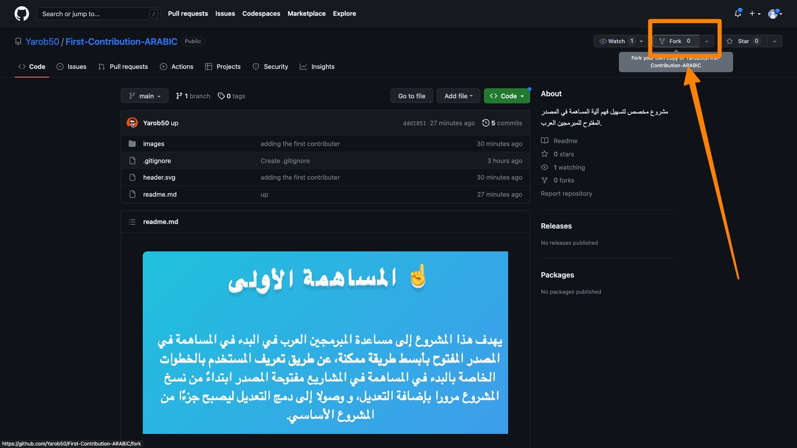

<br>

## ٢- قم بتأكيد البيانات و الضغط على fork

لا تحتاج إلى تغيير أي من البيانات الظاهرة و يمكنك الضغط على fork مباشرة

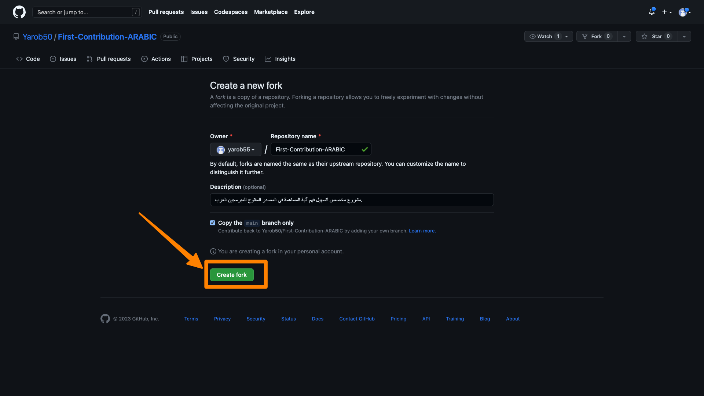

<br>

## ٣- سيتم إنشاء نسخة جديدة من المشروع

لاحظ ظهور اسمك و من ثم اسم المستودع مما يعني أنك حصلت على نسخة مستقلة من المشروع أصبحت تابعة لحسابك الشخصي.

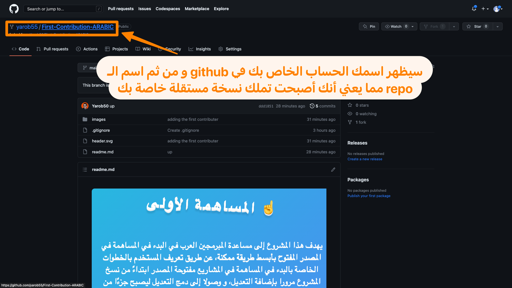

<br>

## ٤- قم بتنزيل المشروع

يتم التنزيل من خلال الضغط على زر `code` و من ثم اختيار أحد خيارات التحميل مثل: `download zip`.

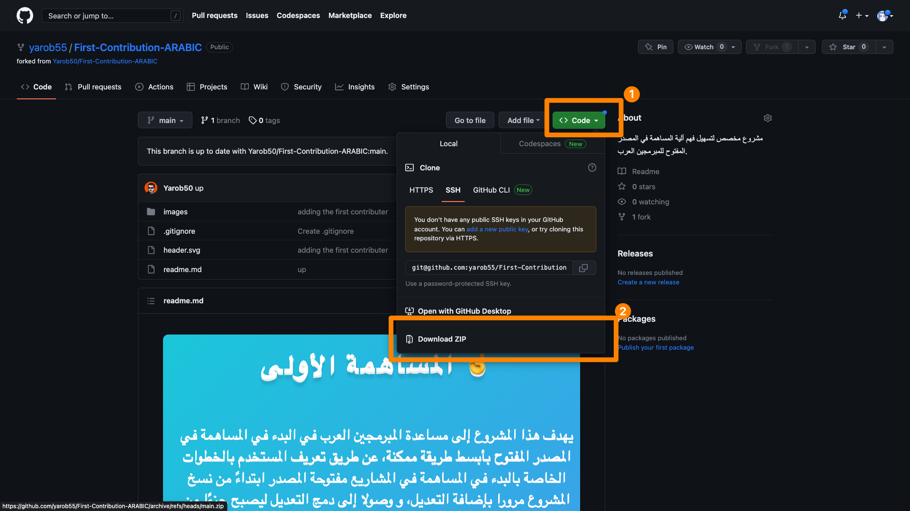

<br>

## ٥- افتح المشروع في في محرر الأكواد

يمكنك اختيار محرر الأكواد المناسب لك، قم بفتح المشروع من خلاله و من ثم توجه إلى ملف ال `readme.md`.

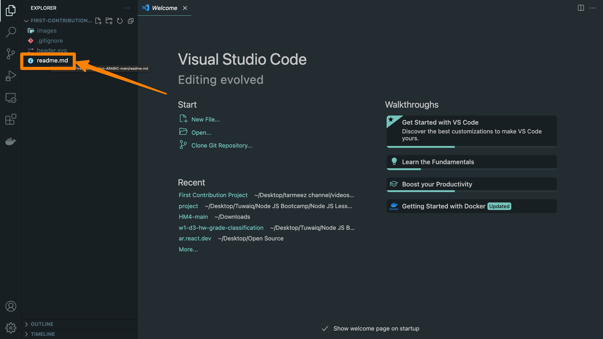

<br>

## ٦- حدد الجزء المطلوب و قم بنسخه

ستجد المكان الذي يحددلك مكان النسخ حيث يجب عليك النسخ من بداية ال `<tr>` و صولا إلى نهايته `</tr>`

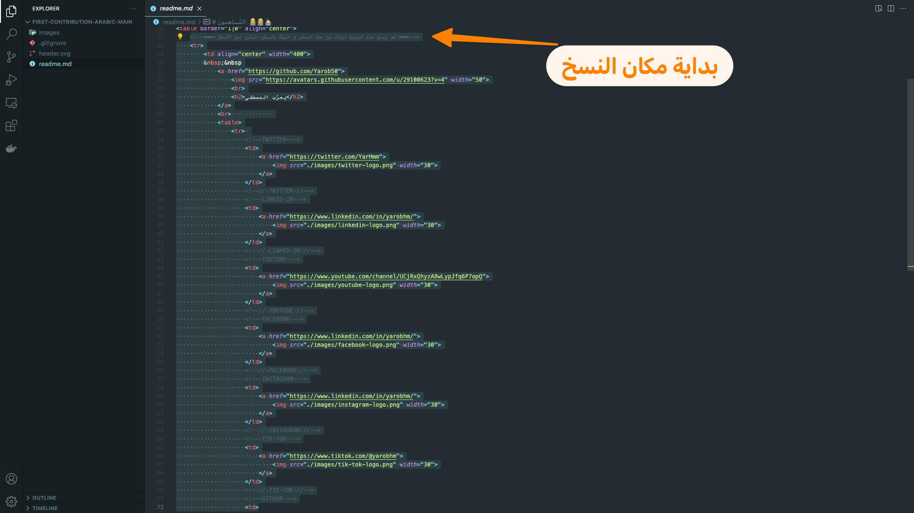


<br>

## ٧- قم باللصق و تحديث البيانات

تأكد من تحديث البيانات بعد اللصق و قم بحدف بيانات حساباتك في المنصات التي لا تريد لها أن تظهر.

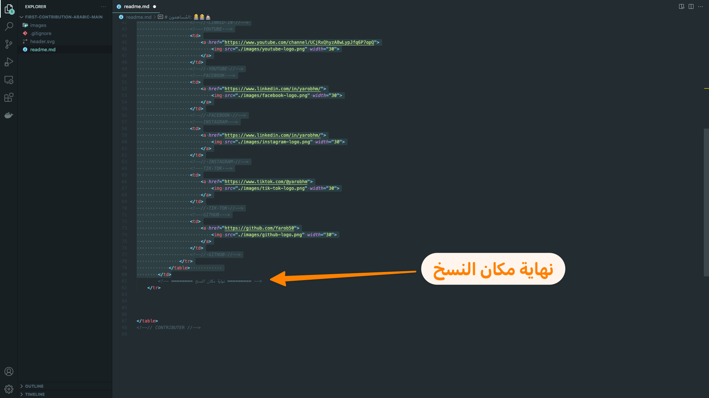

<br>

## ٨- قم بعمل `git init` في حال لم تقم بالتنزيل باستخدام `git clone...`.

ستحتاج هذا الأمر في حال اتبعت طريقة التنزيل اليدوية المذكورة في هذا الشرح عن طريق (donwload zip file).

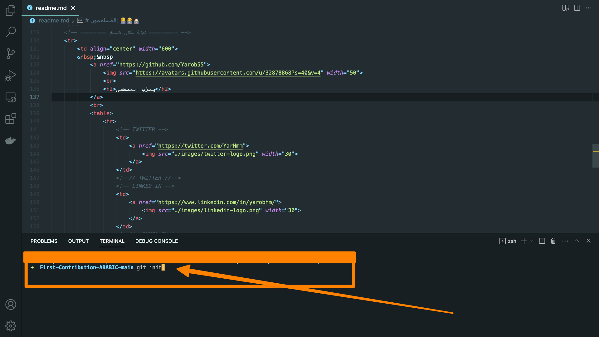

<br>

## ٩- قم بعمل `git add .` و من ثم `git commit` لحفظ التغييرات.

هذا سيقوم بحفظ التغييرات لديك محليا في الجهاز استعدادا لرفعها للمستودع (الخاص بك)

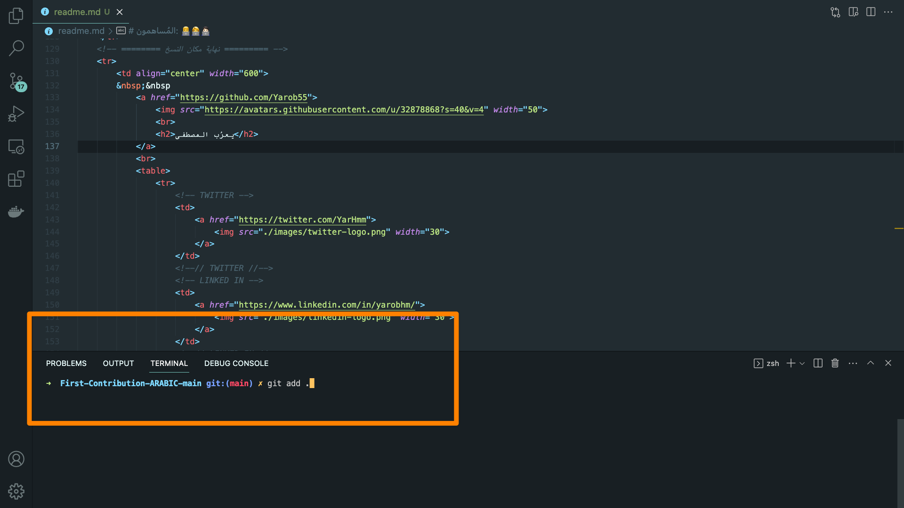

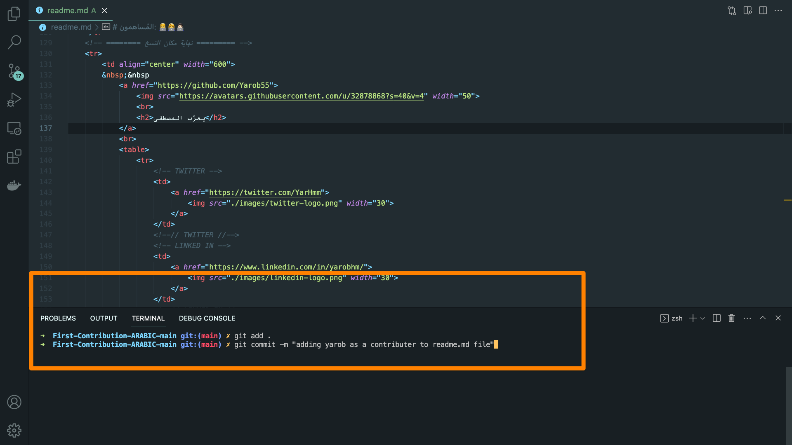

<br>

## ١٠ - في حال تنزيلك للمستودع بالطريقة اليدوية عليك أن تقوم بإضافة ال remote

لن يعمل معك أمر `git push origin main` مباشرة في حال التنزيل اليدوي و إنما عليك أن تقوم بإضافة ال `remote` أولا،
و المقصود بذلك أن تحدد المستودع من github الذي يمثل المكان الذي سيتم رفع الكود إليه في حال تم عمل `git push origin main`.
و ذلك من خلال نسخ الرابط من زر `code` من نسخة المستودع الخاصة بك و من ثم استخدامه في الأمر التالي:

```
    git remote add origin <your rep url here>
```

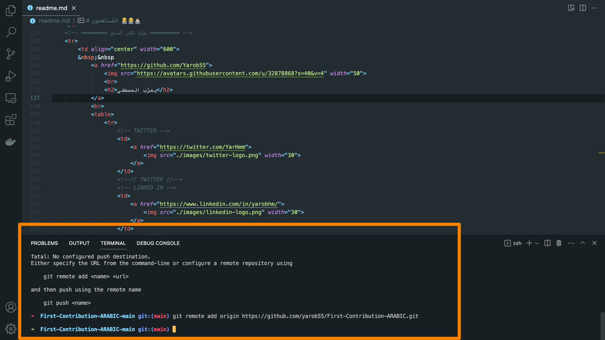

<br>

## ١١- قم برفع التغييرات إلى مستودعك

قم برفع التغييرات باستخدام الأمر: `git push origin main`.
هذا سيقوم برفع التغييرات إلى نسختك من المستودع و ليس إلى النسخة الأصلية التي قمت بعمل ال Fork منها.

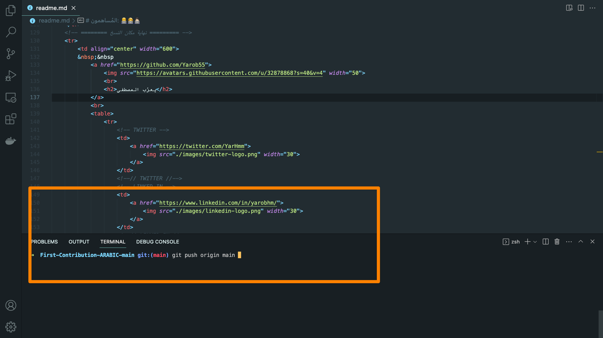

<br>

## ١٢- قم بفتح نسخة المستودع الخاصة بك

تأكد أنك فتحت نسخة المستودع الخاصة بحسابك في github و ليس النسخة الأصلية من المشروع، ستلاحظ أن التغيير الذي قمت بعمله قد تم إضافته

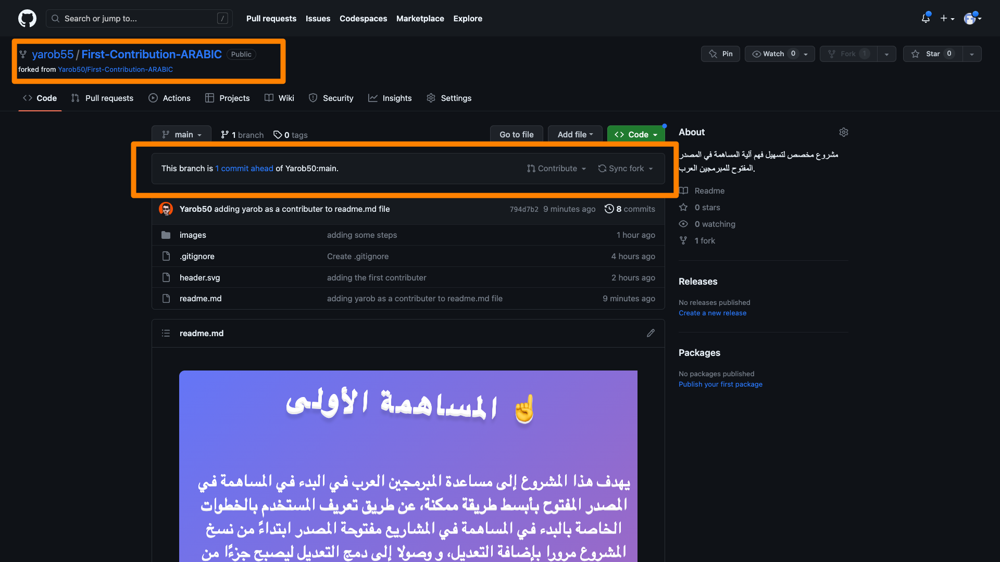
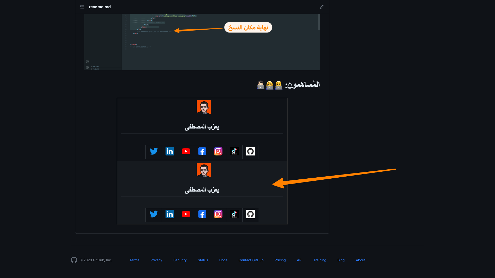

<br>

## ١٣- قم بعمل ال Pull Request

قم بعمل ال pull request كما هو موضح في الصورة و هي طريقة لطلب اعتماد التغيير الذي قمت به في النسخة الأصلية من المشروع.
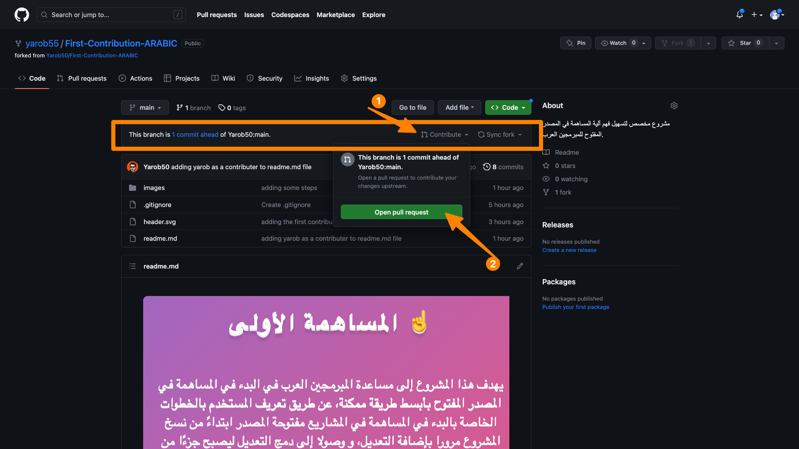

<br>

## ١٤- قم بإرسال ال Pull Request

قم بتعبئة البيانات كما هو موضح في الصورة و من ثم اعتمد إرسال ال pull request عن طريق الضغط على create pull request.
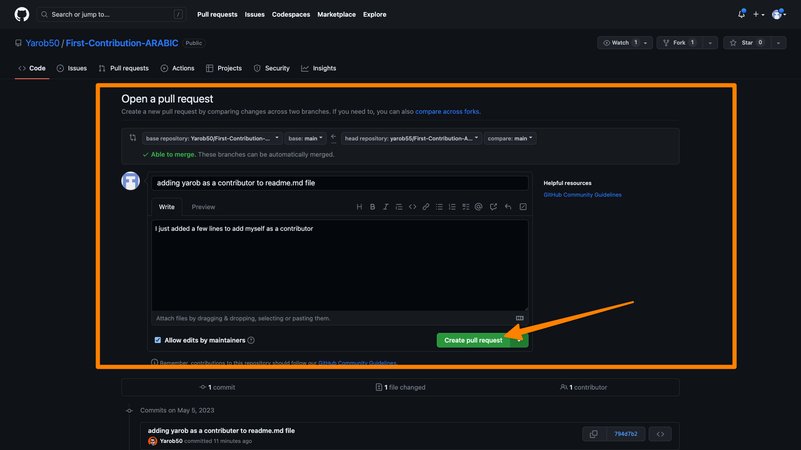

<br>

## ١٥- انتظر حتى يتم اعتماد طلبك

بعد ذلك سيصل طلبك إلي و في حال عدم وجود أية ملاحظات فسأقوم باعتماده ليصبح جزءًا من المشروع الأصلي و يتم إضافتك إلى قائمة المساهمين، حينها ستكون قد أتممت مساهمتك الأولى في المصدر المفتوح. 👌🏻😄


---

<br>
<br>

# المُساهمون: 👨‍💻👩‍💻🧑🏻‍💻

<!-- CONTRIBUTER -->
<table border="1|0" align="center">
    <!--=== قم بنسخ هذه الجزئية ابتداءً من هذا السطر و انتهاءً بالسطر المذكور في الأسفل ===-->
    <tr>
        <td align="center" width="600">
        &nbsp;&nbsp
            <a href="https://github.com/Yarob50">
                
                <br>
                <h2>يعرُب المصطفى</h2>
            </a>
            <br>            
            <table>
                <tr> 
                    <!-- TWITTER -->
                    <td>
                        <a href="https://twitter.com/YarHmm">
                            
                        </a>
                    </td>
                    <!--// TWITTER //-->
                    <!-- LINKED IN -->
                    <td>
                        <a href="https://www.linkedin.com/in/yarobhm/">
                            
                        </a>
                    </td>
                    <!--// LINKED IN //-->
                    <!-- YOUTUBE -->
                    <td>
                        <a href="https://www.youtube.com/channel/UCjRxQhyzA8wLypJfq6P7opQ">
                            
                        </a>
                    </td>
                    <!--// YOUTUBE //-->
                    <!-- FACEBOOK -->
                    <td>
                        <a href="https://www.linkedin.com/in/yarobhm/">
                            
                        </a>
                    </td>
                    <!--// FACEBOOK //-->
                    <!-- INSTAGRAM -->
                    <td>
                        <a href="https://www.linkedin.com/in/yarobhm/">
                            
                        </a>
                    </td>
                    <!--// INSTAGRAM //-->
                    <!-- TIK TOK -->
                    <td>
                        <a href="https://www.tiktok.com/@yarobhm">
                            
                        </a>
                    </td>
                    <!--// TIK TOK //-->
                    <!-- GITHUB -->
                    <td>
                        <a href="https://github.com/Yarob50">
                            
                        </a>
                    </td>
                    <!--// GITHUB //-->
                </tr>
            </table>            
        </td>
    </tr>
    <!-- ======== نهاية مكان النسخ ========= --> 
    <tr>
        <td align="center" width="600">
        &nbsp;&nbsp
            <a href="https://github.com/yarob55">
                
                <br>
                <h2>Yarob Al Mostafa</h2>
            </a>
            <br>            
            <table>
                <tr> 
                    <!-- TWITTER -->
                    <td>
                        <a href="https://twitter.com/YarHmm">
                            
                        </a>
                    </td>
                    <!--// TWITTER //-->
                    <!-- LINKED IN -->
                    <td>
                        <a href="https://www.linkedin.com/in/yarobhm/">
                            
                        </a>
                    </td>
                    <!--// LINKED IN //-->
                    <!-- YOUTUBE -->
                    <td>
                        <a href="https://www.youtube.com/channel/UCjRxQhyzA8wLypJfq6P7opQ">
                            
                        </a>
                    </td>
                    <!--// YOUTUBE //-->
                    <!-- TIK TOK -->
                    <td>
                        <a href="https://www.tiktok.com/@yarobhm">
                            
                        </a>
                    </td>
                    <!--// TIK TOK //-->
                    <!-- GITHUB -->
                    <td>
                        <a href="https://github.com/yarob55">
                            
                        </a>
                    </td>
                    <!--// GITHUB //-->
                </tr>
            </table>            
        </td>
    </tr>    
     <tr>
        <td align="center" width="600">
        &nbsp;&nbsp
            <a href="https://github.com/dr-almukhtar">
                
                <br>
                <h2> Dr. Muhannad Almukhtar </h2>
            </a>
            <br>            
            <table>
                <tr> 
                    <!-- GITHUB -->
                    <td>
                        <a href="https://github.com/dr-almukhtar">
                            
                        </a>
                    </td>
                    <!--// GITHUB //-->
                </tr>
            </table>            
        </td>
    </tr>
    <tr>
        <td align="center" width="600">
        &nbsp;&nbsp
            <a href="https://github.com/SaifSaidi">
                
                <br>
                <h2>Saif Saidi</h2>
            </a>
            <br>            
            <table>
                <tr>
                    <!-- GITHUB -->
                    <td>
                        <a href="https://github.com/SaifSaidi">
                          
                        </a>
                    </td>
                    <!--// GITHUB //-->
                </tr>
            </table>            
        </td>
    </tr>
    <tr>
        <td align="center" width="600">
            &nbsp;&nbsp
            <a href="https://github.com/Mazin-Fouad">
                
                <br />
                <h2>مازن فؤاد</h2>
            </a>
            <br />
            <table>
                <tr>
                    <!-- LINKED IN -->
                    <td>
                    <a href="linkedin.com/in/mazin-fouad-332b36266">
                        
                    </a>
                    </td>
                    <!--// LINKED IN //-->
                    <!-- GITHUB -->
                    <td>
                    <a href="https://github.com/Mazin-Fouad">
                        
                    </a>
                    </td>
                    <!--// GITHUB //-->
                </tr>
            </table>
        </td>
    </tr>
    <tr>
        <td align="center" width="600">
        &nbsp;&nbsp
            <a href="https://github.com/Mohamed-avr">
                
                <br>
                <h2> mohamed boukhanouf </h2>
            </a>
            <br>            
            <table>
                <tr>
                    <!-- TWITTER -->
                    <td>
                        <a href="https://twitter.com/MohamedBoukhan5">
                            
                        </a>
                    </td>
                    <!--// TWITTER //-->
                    <!-- LINKED IN -->
                    <td>
                        <a href="https://www.linkedin.com/in/mohamed-boukhanouf-796583201/">
                            
                        </a>
                    </td>
                    <!--// LINKED IN //-->
                    <!-- FACEBOOK -->
                    <td>
                        <a href="">
                            
                        </a>
                    </td>
                    <!--// FACEBOOK //-->
                    <!-- GITHUB -->
                    <td>
                        <a href="https://github.com/Mohamed-avr">
                            
                        </a>
                    </td>
                    <!--// GITHUB //-->
                </tr>
            </table>
        </td>
    </tr>
    <tr>
        <td align="center" width="600">
        &nbsp;&nbsp
            <a href="https://github.com/youshakh">
                
                <br>
                <h2>yousha khadra</h2>
            </a>
            <br>            
            <table>
                <tr> 
                    <!-- FACEBOOK -->
                    <td>
                        <a href="https://www.facebook.com/yousha.khadra">
                            
                        </a>
                    </td>
                    <!--// FACEBOOK //-->
                    <!--// INSTAGRAM //-->
                    <!-- TIK TOK -->
                    <td>
                        <a href="https://www.tiktok.com/@yousha_khadra?is_from_webapp=1&sender_device=pc">
                            
                        </a>
                    </td>
                    <!--// TIK TOK //-->
                    <!-- GITHUB -->
                    <td>
                        <a href="https://github.com/youshakh">
                        
                        </a>
                    </td>
                    <!--// GITHUB //-->
                </tr>
            </table>
        </td>
        <tr>
        <td align="center" width="600">
        &nbsp;&nbsp
            <a href="https://github.com/NinaLoop">
                
                <br>
                <h2>NinaLoop</h2>
            </a>
            <br>            
            <table>
                <tr> 
                    <!-- TWITTER -->
                    <td>
                        <a href="https://twitter.com/ninaloop_">
                            
                        </a>
                    </td>
                    <!--// TWITTER //-->
                    <!-- GITHUB -->
                    <td>
                        <a href="https://github.com/NinaLoop">
                            
                        </a>
                    </td>
                    <!--// GITHUB //-->
                </tr>
            </table>            
        </td>
    </tr>
    <tr>
        <td align="center" width="600">
        &nbsp;&nbsp
            <a href="https://github.com/Marchq21">
                
                <br>
                <h2>Marouane Chq</h2>
            </a>
            <br>            
            <table>
                <tr> 
                    <!-- TWITTER -->
                    <td>
                        <a href="https://twitter.com/marouane_chf">
                            
                        </a>
                    </td>
                    <!--// TWITTER //-->
                    <!-- GITHUB -->
                    <td>
                        <a href="https://github.com/Marchq21">
                            
                        </a>
                    </td>
                    <!--// GITHUB //-->
                </tr>
            </table>            
        </td>
    </tr>
    <tr>
        <td align="center" width="600">
        &nbsp;&nbsp
            <a href="https://github.com/Ebrahim33/Ebrahim33.github.io.git">
                
                <br>
                <h2>ابراهيم الخطيب</h2>
            </a>
            <br>            
            <table>
                <tr> 
                    <!-- TWITTER -->
                    <td>
                        <a href="https://twitter.com/awo444">
                            
                        </a>
                    </td>
                    <!--// TWITTER //-->
                    <!-- LINKED IN -->
                    <td>
                        <a href="https://www.linkedin.com/in/ebrahim-alkhatib-4859aa244">
                            
                        </a>
                    </td>
                    <!--// LINKED IN //-->
                    <!-- GITHUB -->
                    <td>
                        <a href="https://github.com/Ebrahim33/Ebrahim33.github.io.git">
                            
                        </a>
                    </td>
                    <!--// GITHUB //-->
                </tr>
            </table>            
        </td>
    </tr>
    <tr>
        <td align="center" width="600">
        &nbsp;&nbsp
            <a href="https://github.com/maryam800">
                
                <br>
                <h2>Maryam Ali</h2>
            </a>
            <br>            
            <table>
                <tr> 
                    <!-- TWITTER -->
                    <td>
                        <a href="https://twitter.com/MaryamA29096677">
                            
                        </a>
                    </td>
                    <!--// TWITTER //-->
                    <!-- LINKED IN -->
                    <td>
                        <a href="https://www.linkedin.com/in/maryam-ali-191a53130/">
                            
                        </a>
                    </td>
                    <!--// LINKED IN //-->
                    <!-- GITHUB -->
                    <td>
                        <a href="https://github.com/maryam800">
                            
                        </a>
                    </td>
                    <!--// GITHUB //-->
                </tr>
            </table>            
        </td>
    </tr>
    <tr>
        <td align="center" width="600">
        &nbsp;&nbsp
            <a href="https://github.com/kahkaj">
                
                <br>
                <h2>محمد محسن</h2>
            </a>
            <br>            
            <table>
                <tr> 
                    <!-- TWITTER -->
                    <td>
                        <a href="https://twitter.com/Mohcine17619305">
                            
                        </a>
                    </td>
                    <!--// TWITTER //-->
                    <!-- GITHUB -->
                    <td>
                        <a href="https://github.com/kahkaj">
                            
                        </a>
                    </td>
                    <!--// GITHUB //-->
                </tr>
            </table>            
        </td>
    </tr>
    <!-- AHMAD SINAN -->
    <tr>
        <td align="center" width="600">
        &nbsp;&nbsp
            <a href="https://github.com/Dev-AhmedOmer">
                
                <br>
                <h2>أحمد السناني</h2>
            </a>
            <br>            
            <table>
                <tr> 
                    <!-- TWITTER -->
                    <td>
                        <a href=
                            
                        </a>
                    </td>
                    <!--// TWITTER //-->
                    <!-- LINKED IN -->
                    <td>
                        <a href="https://www.linkedin.com/in/yarobhm/">
                            
                        </a>
                    </td>
                    <!--// LINKED IN //-->
                    <!-- YOUTUBE -->
                    <td>
                        <a href="https://www.youtube.com/channel/UCjRxQhyzA8wLypJfq6P7opQ">
                            
                        </a>
                    </td>
                    <!--// YOUTUBE //-->
                    <!-- FACEBOOK -->
                    <td>
                        <a href="https://www.facebook.com/a7mdOmr/">
                            
                        </a>
                    </td>
                    <!--// FACEBOOK //-->
                    <!-- INSTAGRAM -->
                    <td>
                        <!-- <a href="https://www.linkedin.com/in/yarobhm/">
                            
                        </a> -->
                    </td>
                    <!--// INSTAGRAM //-->
                    <!-- TIK TOK -->
                    <td>
                        <a href="https://www.tiktok.com/@yarobhm">
                            
                        </a>
                    </td>
                    <!--// TIK TOK //-->
                    <!-- GITHUB -->
                    <td>
                        <a href="https://github.com/Dev-AhmedOmer">
                            
                        </a>
                    </td>
                    <!--// GITHUB //-->
                </tr>
            </table>            
        </td>
    </tr>
    <!--// AHMAD SINAN //-->
    <!-- FAYYAD -->
    <tr>
        <td align="center" width="600">
        &nbsp;&nbsp
            <a href="https://github.com/mohamdFayyad">
                
                <br>
                <h2>Mohamed Fayyad</h2>
            </a>
            <br>            
            <table>
                <tr>
                    <!-- LINKED IN -->
                    <td>
                        <a href="https://www.linkedin.com/in/mohamed-fayyad-48298922a/">
                            
                        </a>
                    </td>
                    <!--// LINKED IN //-->
                    <!-- GITHUB -->
                    <td>
                        <a href="https://github.com/mohamdFayyad">
                            
                        </a>
                    </td>
                    <!--// GITHUB //-->
                </tr>
            </table>            
        </td>
    </tr>
    <!--// FAYYAD //-->
    <!-- MOHAMMED ALSAEADY -->
    <tr>
        <td align="center" width="600">
        &nbsp;&nbsp
            <a href="https://github.com/Mandela95">
                
                <br>
                <h2>Mohamed Elseady</h2>
            </a>
            <br>            
            <table>
                <tr> 
                    <!-- TWITTER -->
                    <td>
                        <a href="https://twitter.com/MohElseady">
                            
                        </a>
                    </td>
                    <!--// TWITTER //-->
                    <!-- LINKED IN -->
                    <td>
                        <a href="https://www.linkedin.com/in/mo-seady/">
                            
                        </a>
                    </td>
                    <!--// LINKED IN //-->
                    <!-- FACEBOOK -->
                    <td>
                        <a href="https://www.facebook.com/hamoelseady/">
                            
                        </a>
                    </td>
                    <!--// FACEBOOK //-->
                    <!-- INSTAGRAM -->
                    <td>
                        <a href="https://www.instagram.com/els3eedy/">
                            
                        </a>
                    </td>
                    <!--// INSTAGRAM //-->
                    <!-- GITHUB -->
                    <td>
                        <a href="https://github.com/Mandela95">
                            
                        </a>
                    </td>
                    <!--// GITHUB //-->
                </tr>
            </table>            
        </td>
    </tr>
    <!--// MOHAMMED ALSAEADY //-->
    <!-- MUHA -->
    <tr>
        <td align="center" width="600">
        &nbsp;&nbsp
            <a href="https://github.com/nmcev">
                
                <br>
                <h2>muha</h2>
            </a>
            <br>            
            <table>
                <tr> 
                    <!-- LINKED IN -->
                    <td>
                        <a href="https://www.linkedin.com/in/muhammed-khalid-2058b5251/">
                            
                        </a>
                    </td>
                    <!--// LINKED IN //-->
                    <!-- GITHUB -->
                    <td>
                        <a href="https://github.com/nmcev">
                            
                        </a>
                    </td>
                    <!--// GITHUB //-->
                </tr>
            </table>            
        </td>
    </tr>
    <!-- MUHA -->
    <tr>
        <td align="center" width="600">
        &nbsp;&nbsp
            <a href="https://github.com/Mohammed-Berir">
                
                <br>
                <h2>محمد مصطفى</h2>
            </a>
            <br>            
            <table>
                <tr> 
                    <!-- GITHUB -->
                    <td>
                        <a href="https://github.com/Mohammed-Berir">
                            
                        </a>
                    </td>
                    <!--// GITHUB //-->
                </tr>
            </table>            
        </td>
    </tr>
    <!-- HamzaDev -->
    <tr>
        <td align="center" width="600">
        &nbsp;&nbsp
            <a href="https://github.com/HamzaElkotp">
                
                <br>
                <h2>HamzaDev //HamzaElkotb</h2>
            </a>
            <br>            
            <table>
                <tr> 
                    <!-- TWITTER -->
                    <td>
                        <a href="https://twitter.com/HamzaElkotp">
                            
                        </a>
                    </td>
                    <!--// TWITTER //-->
                    <!-- LINKED IN -->
                    <td>
                        <a href="https://www.linkedin.com/in/HamzaElkotp">
                            
                        </a>
                    </td>
                    <!--// LINKED IN //-->
                    <!-- YOUTUBE -->
                    <td>
                        <a href=" https://www.youtube.com/@DevCoder">
                            
                        </a>
                    </td>
                    <!--// YOUTUBE //-->
                    <!-- FACEBOOK -->
                    <td>
                        <a href="https://www.facebook.com/HamzaElkotp">
                            
                        </a>
                    </td>
                    <!--// FACEBOOK //-->
                    <!-- INSTAGRAM -->
                    <td>
                        <a href="https://www.instagram.com/HamzaElkotp">
                            
                        </a>
                    </td>
                    <!--// INSTAGRAM //-->
                    <!-- GITHUB -->
                    <td>
                        <a href="https://github.com/HamzaElkotp">
                            
                        </a>
                    </td>
                    <!--// GITHUB //-->
                </tr>
            </table>            
        </td>
    </tr>
    <!-- HamzaDev -->
    <!-- ABDULKARIM -->
    <tr>
        <td align="center" width="600">
        &nbsp;&nbsp
            <a href="https://github.com/abdulkerim-awad">
                
                <br>
                <h2>Abdulkerim Awad</h2>
            </a>
            <br>            
            <table>
                <tr> 
                    <!-- GITHUB -->
                    <td>
                        <a href="https://github.com/abdulkerim-awad">
                            
                        </a>
                    </td>
                    <!--// GITHUB //-->
                    <!-- LINKED IN -->
                    <td>
                        <a href="https://www.linkedin.com/in/abdulkerim-awad-92652321a/">
                            
                        </a>
                    </td>
                    <!--// LINKED IN //-->
                    <!-- CodeWars -->
                    <td>
                        <a href="https://www.codewars.com/users/AbdulkerimAwad">
                            
                        </a>
                    </td>
                    <!--// CodeWars //-->
                    <!--// TIK TOK //-->
                    <!-- stackoverflow -->
                    <td>
                        <a href="https://stackoverflow.com/users/14137474/abdulkerim">
                            
                        </a>
                    </td>
                    <!--// stackoverflow //-->
                </tr>
            </table>            
        </td>
    </tr>
    <!-- // ABDULKARIM // -->
    <!-- Zakaria -->
    <tr>
        <td align="center" width="600">
        &nbsp;&nbsp
            <a href="https://github.com/Zaki-Dz">
                
                <br>
                <h2>Zakaria Mameri</h2>
            </a>
            <br>            
            <table>
                <tr> 
                    <!-- LINKED IN -->
                    <td>
                        <a href="https://www.linkedin.com/in/zakaria-mameri-149b13222/">
                            
                        </a>
                    </td>
                    <!--// LINKED IN //-->
                    <!-- GITHUB -->
                    <td>
                        <a href="https://github.com/Zaki-Dz">
                            
                        </a>
                    </td>
                    <!--// GITHUB //-->
                </tr>
            </table>            
        </td>
    </tr>
    <!-- Zakaria -->
    <!-- AMIR Gendy-->
    <tr>
        <td align="center" width="600">
        &nbsp;&nbsp
            <a href="https://github.com/amirgendy">
                
                <br>
                <h2>Amir Gendy Botros</h2>
            </a>
            <br>            
            <table>
                <tr> 
                    <!-- TWITTER -->
                    <td>
                        <a href="https://twitter.com/amir_gendy">
                            
                        </a>
                    </td>
                    <!--// TWITTER //-->
                    <!-- LINKED IN -->
                    <td>
                        <a href="https://www.linkedin.com/in/amirgendybotros/">
                            
                        </a>
                    </td>
                    <!--// LINKED IN //-->
                    <!-- FACEBOOK -->
                    <td>
                        <a href="https://www.facebook.com/AmirGendyBotros/">
                            
                        </a>
                    </td>
                    <!--// FACEBOOK //-->
                    <!-- GITHUB -->
                    <td>
                        <a href="https://github.com/amirgendy">
                            
                        </a>
                    </td>
                    <!--// GITHUB //-->
                </tr>
            </table>            
        </td>
    </tr>
    <!-- Amir Gendy Botros -->
    <!---OWIS BUKHARI-->
      <tr>
        <td align="center" width="600">
        &nbsp;&nbsp
            <a href="https://github.com/owisqari">
                
                <br>
                <h2>اويس بخاري</h2>
            </a>
            <br>            
            <table>
                <tr> 
                    <!-- TWITTER -->
                    <td>
                        <a href="https://twitter.com/OwisBukhari">
                            
                        </a>
                    </td>
                    <!--// TWITTER //-->
                    <!-- LINKED IN -->
                    <td>
                        <a href="hhttps://www.linkedin.com/in/owis-bukhari-6a6b44184/">
                            
                        </a>
                    </td>
                    <!--// LINKED IN //-->
                    <!-- GITHUB -->
                    <td>
                        <a href="https://github.com/owisqari">
                            
                        </a>
                    </td>
                    <!--// GITHUB //-->
                </tr>
            </table>            
        </td>
    </tr>
    <!--// OWIS BUKHARI //-->
     <!-- ReBestX -->
    <tr>
        <td align="center" width="600">
        &nbsp;&nbsp
            <a href="https://github.com/ReBestX">
                
                <br>
                <h2>Ayman Ismail</h2>
            </a>
            <br>            
            <table>
                <tr> 
                    <!-- TWITTER -->
                    <td>
                        <a href="https://twitter.com/rebestx">
                            
                        </a>
                    </td>
                    <!--// TWITTER //-->
                    <!-- LINKED IN -->
                    <td>
                        <a href="https://www.linkedin.com/in/aymanbismail">
                            
                        </a>
                    </td>
                    <!--// LINKED IN //-->
                    <!-- YOUTUBE -->
                    <td>
                        <a href="https://www.youtube.com/c/rebestx">
                            
                        </a>
                    </td>
                    <!--// YOUTUBE //-->
                    <!-- INSTAGRAM -->
                    <td>
                        <a href="https://www.instagram.com/rebestx/">
                            
                        </a>
                    </td>
                    <!--// TIK TOK //-->
                    <!-- GITHUB -->
                    <td>
                        <a href="https://github.com/ReBestX">
                            
                        </a>
                    </td>
                    <!--// GITHUB //-->
                </tr>
            </table>            
        </td>
    </tr>
    <!-- ReBestX -->
    <!-- @a7sa45 -->
    <tr>
        <td align="center" width="600">
        &nbsp;&nbsp
            <a href="https://github.com/a7sa45">
                
                <br>
                <h2>عبدالهادي ال بوسنينه</h2>
            </a>
            <br>            
            <table>
                <tr> 
                    <!-- TWITTER -->
                    <td>
                        <a href="https://twitter.com/a7sa45">
                            
                        </a>
                    </td>
                    <!--// TWITTER //-->
                    <!-- LINKED IN -->
                    <td>
                        <a href="https://www.linkedin.com/in/abdulhadi-al-bo-sninah-576582205/">
                            
                        </a>
                    </td>
                    <!--// LINKED IN //-->
                    <!-- YOUTUBE -->
                    <td>
                        <a href="https://twitter.com/a7sa45">
                            
                        </a>
                    </td>
                    <!--// YOUTUBE //-->
                    <!-- FACEBOOK -->
                    <td>
                        <a href="https://twitter.com/a7sa45">
                            
                        </a>
                    </td>
                    <!--// FACEBOOK //-->
                    <!-- INSTAGRAM -->
                    <td>
                        <a href="https://twitter.com/a7sa45">
                            
                        </a>
                    </td>
                    <!--// INSTAGRAM //-->
                    <!-- TIK TOK -->
                    <td>
                        <a href="https://twitter.com/a7sa45">
                            
                        </a>
                    </td>
                    <!--// TIK TOK //-->
                    <!-- GITHUB -->
                    <td>
                        <a href="https://github.com/a7sa45">
                            
                        </a>
                    </td>
                    <!--// GITHUB //-->
                </tr>
            </table>            
        </td>
    </tr>
    <!-- @a7sa45 -->
    <!-- WESSAM -->
    <tr>
        <td align="center" width="600">
        &nbsp;&nbsp
            <a href="https://github.com/wesam-abutuaimeh">
                
                <br>
                <h2>Wesam Abutaima</h2>
            </a>
            <br>            
            <table>
                <tr> 
                    <!-- TWITTER -->
                    <td>
                        <a href="https://twitter.com/Wesam_Abutaima">
                            
                        </a>
                    </td>
                    <!--// TWITTER //-->
                    <!-- LINKED IN -->
                    <td>
                        <a href="https://www.linkedin.com/in/wesam-abutaima-55b100272/">
                            
                        </a>
                    </td>
                    <!--// LINKED IN //-->
                    <!-- FACEBOOK -->
                    <td>
                        <a href="https://www.facebook.com/wesam.abutaima/">
                            
                        </a>
                    </td>
                    <!--// FACEBOOK //-->
                    <!-- INSTAGRAM -->
                    <td>
                        <a href="https://instagram.com/wesam.abutaima?igshid=ZGUzMzM3NWJiOQ==">
                            
                        </a>
                    </td>
                    <!--// INSTAGRAM //-->
                    <!-- TIK TOK -->
                    <!-- <td>
                        <a href="https://www.tiktok.com/@yarobhm">
                            
                        </a>
                    </td> -->
                    <!--// TIK TOK -->
                    <!-- GITHUB -->
                    <td>
                        <a href="https://github.com/wesam-abutuaimeh">
                            
                        </a>
                    </td>
                    <!--// GITHUB //-->
                    <!-- mostaql -->
                    <td>
                        <a href="https://mostaql.com/u/Wesam_Abutaima">
                            
                        </a>
                    </td>
                    <!--// mostaql //-->
                </tr>
            </table>            
        </td>
    </tr>
    <!--// WESSAM //-->
    <!-- Omar -->
    <tr>
        <td align="center" width="600">
        &nbsp;&nbsp
            <a href="https://github.com/omaratbd7">
                
                <br>
                <h2>عمر</h2>
            </a>
            <br>            
            <table>
                <tr>
                    <!-- LINKED IN -->
                    <td>
                        <a href="https://www.linkedin.com/in/omar-ait-abderrahman/ ">
                            
                        </a>
                    </td>
                    <!--// LINKED IN //-->
                    <!-- GITHUB -->
                    <td>
                        <a href="https://github.com/omaratbd7">
                            
                        </a>
                    </td>
                    <!--// GITHUB //-->
                </tr>
            </table>            
        </td>
    </tr>
    <!--// Omar //-->
    <!--// HASHIM //-->
    <tr>
        <td align="center" width="600">
        &nbsp;&nbsp
            <a href="https://github.com/Pwoerlevel">
                
                <br>
                <h2>هاشم محمد</h2>
            </a>
            <br>            
            <table>
                <tr> 
                    <!-- FACEBOOK -->
                    <td>
                        <a href="https://www.facebook.com/profile.php?id=100069366840910">
                            
                        </a>
                    </td>
                      <!-- // FACEBOOK // -->
                    <!-- GITHUB -->
                    <td>
                        <a href="https://github.com/Pwoerlevel">
                            
                        </a>
                    </td>
                    <!--// GITHUB //-->
                </tr>
            </table>            
        </td>
    </tr>
    <!--// HASHIM //-->
    <!-- // Assem Saeed // -->
    <tr>
        <td align="center" width="600">
        &nbsp;&nbsp
            <a href="https://github.com/assem1637">
                
                <br>
                <h2>Assem Saeed</h2>
            </a>
            <br>            
            <table>
                <tr> 
                    <!-- TWITTER -->
                    <td>
                        <a href="https://twitter.com/xAssomy">
                            
                        </a>
                    </td>
                    <!--// TWITTER //-->
                    <!-- LINKED IN -->
                    <td>
                        <a href="https://www.linkedin.com/in/assem1637/">
                            
                        </a>
                    </td>
                    <!--// LINKED IN //-->
                    <!-- FACEBOOK -->
                    <td>
                        <a href="https://www.facebook.com/Assem.Saeed.Official">
                            
                        </a>
                    </td>
                    <!--// FACEBOOK //-->
                    <!-- INSTAGRAM -->
                    <td>
                        <a href="https://www.instagram.com/xAssomy/">
                            
                        </a>
                    </td>
                    <!--// INSTAGRAM //-->
                    <!-- GITHUB -->
                    <td>
                        <a href="https://github.com/assem1637">
                            
                        </a>
                    </td>
                    <!--// GITHUB //-->
                </tr>
            </table>            
        </td>
    </tr>
    <!-- // Assem Saeed // -->
    <!--// Thamer //-->
    <tr>
        <td align="center" width="600">
        &nbsp;&nbsp
            <a href="https://github.com/ThamerMalki">
                
                <br>
                <h2>The Warchief</h2>
            </a>
            <br>            
            <table>
                <tr> 
                    <!-- TWITTER -->
                    <td>
                        <a href="https://twitter.com/TKuubi">
                            
                        </a>
                    </td>
                    <!--// TWITTER //-->
                    <!-- LINKED IN -->
                    <td>
                        <a href="https://www.linkedin.com/in/thamer-malki/">
                            
                        </a>
                    </td>
                    <!--// LINKED IN //-->
                    <!-- YOUTUBE -->
                    <td>
                        <a href="https://www.youtube.com/@Tkuubi">
                            
                        </a>
                    </td>
                    <!--// YOUTUBE //-->
                    <!-- GITHUB -->
                    <td>
                        <a href="https://github.com/ThamerMalki">
                            
                        </a>
                    </td>
                    <!--// GITHUB //-->
                </tr>
            </table>            
        </td>
    </tr>
    <!--// Thamer //-->
    <!-- IBRAHIM -->
    <tr>
        <td align="center" width="600">
        &nbsp;&nbsp
            <a href="https://github.com/theiphoner">
                
                <br>
                <h2>ابراهيم محمد</h2>
            </a>
            <br>            
            <table>
                <tr> 
                    <!-- TWITTER -->
                    <td>
                        <a href="https://twitter.com/linux_rust">
                            
                        </a>
                    </td>
                    <!--// TWITTER //-->
                    <!-- LINKED IN -->
                    <td>
                        <a href="https://www.linkedin.com/in/ibrahim-m-almalki/">
                            
                        </a>
                    </td>
                    <!--// LINKED IN //-->
                    <!-- YOUTUBE -->
                    <td>
                        <a href="https://www.youtube.com/channel/UCjRxQhyzA8wLypJfq6P7opQ">
                            
                        </a>
                    </td>
                    <!--// YOUTUBE //-->
                    <!-- FACEBOOK -->
                    <td>
                        <a href="https://www.facebook.com/linux.plus.391/">
                            
                        </a>
                    </td>
                    <!--// FACEBOOK //-->
                    <!-- GITHUB -->
                    <td>
                        <a href="https://github.com/theiphoner">
                            
                        </a>
                    </td>
                    <!--// GITHUB //-->
                </tr>
            </table>            
        </td>
    </tr>
    <!--// IBRAHIM //-->
     <!-- TARIQ -->
    <tr>
        <td align="center" width="600">
        &nbsp;&nbsp
            <a href="https://github.com/ELEF-TQ">
                
                <br>
                <h2>TARIQ AIT LAKHLIFT</h2>
            </a>
            <br>            
            <table>
                <tr> 
                    <!-- GITHUB -->
                    <td>
                        <a href="https://github.com/abdulkerim-awad">
                            
                        </a>
                    </td>
                    <!--// GITHUB //-->
                    <!-- LINKED IN -->
                    <td>
                        <a href="https://www.linkedin.com/in/tariq-ait-lakhlift">
                            
                        </a>
                    </td>
                    <!--// LINKED IN //-->
                </tr>
            </table>            
        </td>
    </tr>
    <!-- // TARIQ // -->
    <!-- MEHDI -->
    <tr>
            <td align="center" width="600">
        &nbsp;&nbsp
            <a href="https://github.com/ZouariMehdi">
                
                <br>
                <h2>Zouari Mehdi</h2>
            </a>
            <br>            
            <table>
                <tr> 
                <!-- LINKED IN -->
                    <td>
                        <a href="https://www.linkedin.com/in/zouari-mehdi-b483bb220/">
                            
                        </a>
                    </td>
                    <!--// LINKED IN //-->
                    <!-- YOUTUBE -->
                    <td>
                        <a href="https://www.youtube.com/@ZouariSchool">
                            
                        </a>
                    </td>
                    <!--// YOUTUBE //-->
                    <!-- GITHUB -->
                    <td>
                        <a href="https://avatars.githubusercontent.com/u/29100623?v=4">
                            
                        </a>
                    </td>
                    <!--// GITHUB //-->
                </tr>
            </table>            
        </td>
    </tr>
    <!-- MEHDI -->
    <!-- HASAN -->
     <tr>
        <td align="center" width="600">
        &nbsp;&nbsp
            <a href="https://github.com/itskahrbaa">
                
                <br>
                <h2>حسن ياسر</h2>
            </a>
            <br>            
            <table>
                <tr> 
                    <!-- TWITTER -->
                    <td>
                        <a href="https://twitter.com/itskahrba">
                            
                        </a>
                    </td>
                    <!--// TWITTER //-->
                    <!-- LINKED IN -->
                    <td>
                        <a href="https://www.linkedin.com/in/kahrbaa/">
                            
                        </a>
                    </td>
                    <!--// LINKED IN //-->
                    <!-- YOUTUBE -->
                    <td>
                        <a href="https://bit.ly/Kahrbaa">
                            
                        </a>
                        <a href="https://www.youtube.com/@iamKahrbaa">
                            2
                        </a>
                    </td>
                    <!--// YOUTUBE //-->
                    <td>
                        <a href="https://mostaql.com/u/Kahrbaa">
                            
                        </a>
                    </td>
                    <!--// mostaql //-->
                </tr>
            </table>            
        </td>
    </tr>
    <!--// HASAN  //-->
    <!-- Ahmad -->
    <tr>
        <td align="center" width="600">
        &nbsp;&nbsp
            <a href="https://github.com/Ahmad-JS">
                
                <br>
                <h2>احمد الحربي</h2>
            </a>
            <br>            
            <table>
                <tr> 
                    <!-- TWITTER -->
                    <td>
                        <a href="https://twitter.com/AHMADM6310">
                            
                        </a>
                    </td>
                    <!--// TWITTER //-->
                    <!-- YOUTUBE -->
                    <td>
                        <a href="https://www.youtube.com/@AhmadJS">
                            
                        </a>
                    </td>
                    <!--// YOUTUBE //-->
                    <!-- GITHUB -->
                    <td>
                        <a href="https://github.com/Ahmad-JS">
                            
                        </a>
                    </td>
                    <!--// GITHUB //-->
                </tr>
            </table>            
        </td>
    </tr>
    <!--// Ahmad //-->
    <!-- MBahusayn -->
    <tr>
        <td align="center" width="600">
        &nbsp;&nbsp
            <a href="https://github.com/mbahusayn">
                
                <br>
                <h2> Mohammed Bahusayn </h2>
            </a>
            <br>            
            <table>
                <tr> 
                    <!-- TWITTER -->
                    <td>
                        <a href="https://twitter.com/MBahusayn">
                            
                        </a>
                    </td>
                    <!--// TWITTER //-->
                    <!-- LINKED IN -->
                    <td>
                        <a href="https://www.linkedin.com/in/mbahusayn/">
                            
                        </a>
                    </td>
                    <!--// LINKED IN //-->
                    <!-- GITHUB -->
                    <td>
                        <a href="https://github.com/MBahusayn">
                            
                        </a>
                    </td>
                    <!--// GITHUB //-->
                </tr>
            </table>            
        </td>
    </tr>
    <!--// MBahusayn //-->
    <!-- JOLAQ -->
    <tr>
        <td align="center" width="600">
        &nbsp;&nbsp
            <a href="https://github.com/jolaq227">
                
                <br>
                <h2> Muhammed Jolaq </h2>
            </a>
            <br>            
            <table>
                <tr> 
                    <!-- TWITTER -->
                    <td>
                        <a href="https://twitter.com/Jolak227">
                            
                        </a>
                    </td>
                    <!--// TWITTER //-->
                    <!-- LINKED IN -->
                    <td>
                        <a href="https://www.linkedin.com/in/muhammed-colak/">
                            
                        </a>
                    </td>
                    <!--// LINKED IN //-->
                    <!-- INSTAGRAM -->
                    <td>
                        <a href="https://instagram.com/jolak_227">
                            
                        </a>
                    </td>
                    <!--// INSTAGRAM //-->
                    <!-- GITHUB -->
                    <td>
                        <a href="https://github.com/jolaq227">
                            
                        </a>
                    </td>
                    <!--// GITHUB //-->
                </tr>
            </table>            
        </td>
    </tr>
    <!--// JOLAQ //-->                  
    <!--// Zyadfallatah //-->
    <tr>
        <td align="center" width="600">
        &nbsp;&nbsp
            <a href="https://github.com/zyadfallatah">
                
                <br>
                <h2>zyadfallatah</h2>
            </a>
            <br>            
            <table>
                <tr> 
                    <!-- TWITTER -->
                    <td>
                        <a href="https://twitter.com/zyad_fallatah">
                            
                        </a>
                    </td>
                    <!--// TWITTER //-->
                    <!-- INSTAGRAM -->
                    <td>
                        <a href="https://www.instagram.com/zyadfal/">
                            
                        </a>
                    </td>
                    <!--// INSTAGRAM //-->
                    <!-- GITHUB -->
                    <td>
                        <a href="https://github.com/zyadfallatah">
                            
                        </a>
                    </td>
                    <!--// GITHUB //-->
                </tr>
            </table>            
        </td>
    </tr>
    <!--// Zyadfallatah //-->
    <!-- Badr Alwattar -->
    <tr>
        <td align="center" width="600">
        &nbsp;&nbsp
            <a href="https://github.com/badr-alwattar">
                
                <br>
                <h2> Badr Alwattar </h2>
            </a>
            <br>            
            <table>
                <tr> 
                    <!-- TWITTER -->
                    <td>
                        <a href="https://twitter.com/badr_alwattar">
                            
                        </a>
                    </td>
                    <!--// TWITTER //-->
                    <!-- LINKED IN -->
                    <td>
                        <a href="https://www.linkedin.com/in/bader-eddin-alwattar">
                            
                        </a>
                    </td>
                    <!--// LINKED IN //-->
                    <!-- GITHUB -->
                    <td>
                        <a href="https://github.com/badr-alwattar">
                            
                        </a>
                    </td>
                    <!--// GITHUB //-->
                </tr>
            </table>            
        </td>
    </tr>
    <!--// Badr Alwattar //--> 
    <!--// Mohamed CHAKIR //-->
    <tr>
        <td align="center" width="600">
        &nbsp;&nbsp
            <a href="https://github.com/Ahmad-JS">
                
                <br>
                <h2>Mohamed CHAKIR</h2>
            </a>
            <br>            
            <table>
                <tr> 
                    <!-- GITHUB -->
                    <td>
                        <a href="https://github.com/ChakirMohamed/">
                            
                        </a>
                    </td>
                    <!--// GITHUB //-->
                    <!-- LINKED IN -->
                    <td>
                        <a href="https://www.linkedin.com/in/chakirmohamed/">
                            
                        </a>
                    </td>
                    <!--// LINKED IN //-->
                </tr>
            </table>            
        </td>
    </tr>
    <!--// Mohamed CHAKIR //-->
    <!--// Abdelrahmna A.Z //-->
    <tr>
        <td align="center" width="600">
        &nbsp;&nbsp
            <a href="https://github.com/A-AZ">
                <br>
                <h2>Abdelrahman Abu Zahra</h2>
            </a>
            <br>            
            <table>
                <tr>
                    <!--// LINKEDIN //-->
                    <td>
                        <a href="https://www.linkedin.com/in/abdelrahman-abu-zahra/">
                            
                        </a>
                    </td>
                    <!--// LINKEDIN //-->
                    <!--// GITHUB //-->
                    <td>
                        <a href="https://github.com/A-AZ">
                            
                        </a>
                    </td>
                    <!--// GITHUB //-->
                </tr>
            </table>            
        </td>
    </tr>
    <!--// Abdelrahman A.Z //-->
    <!-- // Rabil Ibraiel // -->
        <tr>
        <td align="center" width="600">
        &nbsp;&nbsp
            <a href="https://github.com/Rabil-Ibraiel">
                
                <br>
                <h2>Rabil Ibraile</h2>
            </a>
            <br>            
            <table>
                <tr> 
                    <!-- LINKED IN -->
                    <td>
                        <a href="https://www.linkedin.com/in/rabil-ibraiel-b37646215/">
                            
                        </a>
                    </td>
                    <!--// LINKED IN //-->
                    <!-- GITHUB -->
                    <td>
                        <a href="https://github.com/Rabil-Ibraiel">
                            
                        </a>
                    </td>
                    <!--// GITHUB //-->
                </tr>
            </table>            
        </td>
    </tr>
    <!-- // Rabil Ibraiel // -->
    <!-- MOHAMMED -->
    <tr>
        <td align="center" width="600">
        &nbsp;&nbsp
            <a href="https://github.com/mohamed404eg">
                
                <br>
                <h2>Mohamed Ramadn</h2>
            </a>
            <br>            
            <table>
                <tr> 
                    <!-- TWITTER -->
                    <td>
                        <a href="https://twitter.com/mohamed404eg">
                            
                        </a>
                    </td>
                    <!--// TWITTER //-->
                    <!-- LINKED IN -->
                    <td>
                        <a href="https://www.linkedin.com/in/mohamed404eg/">
                            
                        </a>
                    </td>
                    <!--// LINKED IN //-->
                    <!-- FACEBOOK -->
                    <td>
                        <a href="https://www.facebook.com/mohamed404eg">
                            
                        </a>
                    </td>
                    <!--// FACEBOOK //-->
                    <!-- GITHUB -->
                    <td>
                        <a href="https://github.com/mohamed404eg">
                            
                        </a>
                    </td>
                    <!--// GITHUB //-->
                </tr>
            </table>            
        </td>
    </tr>
    <!-- // MOHAMMED // -->
    <!-- HANNANE -->
    <tr>
        <td align="center" width="600">
        &nbsp;&nbsp
            <a href="https://github.com/Hanane1991">
                
                <br>
                <h2>حنان  Hanane</h2>
            </a>
            <br>            
            <table>
                <tr>
                    <!-- GITHUB -->
                    <td>
                        <a href="https://github.com/Hanane1991">
                            
                        </a>
                    </td>
                    <!--// GITHUB //-->
                </tr>
            </table>            
        </td>
    </tr>
    <!--// HANNANE //-->
    <!-- // Ahmed Maadh // -->
        <tr>
        <td align="center" width="600">
        &nbsp;&nbsp
            <a href="https://github.com/AhmedMaadh">
                
                <br>
                <h2>Ahmed Maadh</h2>
            </a>
            <br>            
            <table>
                <tr> 
                    <!-- TWITTER -->
                    <td>
                        <a href="https://twitter.com/AhmedMaadh7">
                            
                        </a>
                    </td>
                    <!--// TWITTER //-->
                    <!-- GITHUB -->
                    <td>
                        <a href="https://github.com/AhmedMaadh">
                            
                        </a>
                    </td>
                    <!--// GITHUB //-->
                </tr>
            </table>            
        </td>
    </tr>
    <!-- // Ahmed Maadh // -->
    <!-- billal benzazoua -->
        <tr>
        <td align="center" width="600">
        &nbsp;&nbsp
            <a href="https://github.com/billalben">
                
                <br>
                <h2>Billal Benzazoua</h2>
            </a>
            <br>            
            <table>
                <tr> 
                    <!-- TWITTER -->
                    <td>
                        <a href="https://twitter.com/Benzazouabillal">
                            
                        </a>
                    </td>
                    <!--// TWITTER //-->
                    <!-- LINKED IN -->
                    <td>
                        <a href="https://www.linkedin.com/in/billal-benzazoua-554144195/">
                            
                        </a>
                    </td>
                    <!--// LINKED IN //-->
                    <!-- FACEBOOK -->
                    <td>
                        <a href="https://www.facebook.com/billal.benzazoua/">
                            
                        </a>
                    </td>
                    <!--// FACEBOOK //-->
                    <!-- GITHUB -->
                    <td>
                        <a href="https://github.com/billalben">
                            
                        </a>
                    </td>
                    <!--// GITHUB //-->
                </tr>
            </table>            
        </td>
    </tr>
    <!-- billal benzazoua -->
    <!--  Maram Saeed  -->
    <tr>
        <td align="center" width="600">
        &nbsp;&nbsp
            <a href="https://github.com/maram-saeed">
                
                <br>
                <h2>Maram Saeed</h2>
            </a>
            <br>            
            <table>
                <tr> 
                    <!-- GITHUB -->
                    <td>
                        <a href="https://github.com/maram-saeed">
                            
                        </a>
                    </td>
                    <!--// GITHUB //-->
                </tr>
            </table>            
        </td>
    </tr>
    <!-- // Maram Saeed // -->
    <!-- KHULOUD ALSHAMMARI -->
    <tr>
        <td align="center" width="600">
        &nbsp;&nbsp
            <a href="https://github.com/khuloudAlshammari">
                
                <br>
                <h2>KHULOUD ALSHAMMARI</h2>
            </a>
            <br>            
            <table>
                <tr> 
                    <!-- GITHUB -->
                    <td>
                        <a href="https://github.com/khuloudAlshammari/Forked">
                            
                        </a>
                    </td>
                    <!--// GITHUB //-->
                    <!-- LINKED IN -->
                    <td>
                        <a href="https://www.linkedin.com/in/khuloudalshammari">
                            
                        </a>
                    </td>
                    <!--// LINKED IN //-->
                </tr>
            </table>            
        </td>
    </tr>
    <!--// KHULOUD ALSHAMMARI //-->
    <!-- Rayen Nasser -->
    <tr>
        <td align="center" width="600">
        &nbsp;&nbsp
            <a href="https://github.com/Rayen-nasser">
                
                <br>
                <h2>Rayen Nasser</h2>
            </a>
            <br>            
            <table>
                <tr> 
                    <!-- GITHUB -->
                    <td>
                        <a href="https://github.com/Rayen-nasser/">
                            
                        </a>
                    </td>
                    <!--// GITHUB //-->
                    <!-- LINKED IN -->
                    <td>
                        <a href="https://www.facebook.com/rayen.nasser.33">
                            
                        </a>
                    </td>
                    <!--// LINKED IN //-->
                    <!-- TWITTER -->
                    <td>
                        <a href="https://twitter.com/rey10976601">
                            
                        </a>
                    </td>
                    <!--// TWITTER //-->
                </tr>
            </table>            
        </td>
    </tr>
    <!--// Rayen Nasser //-->
    <!--// Saud Alghamdi //-->
    <tr>
        <td align="center" width="600">
        &nbsp;&nbsp
            <a href="https://github.com/Saud-Alghamdi">
                
                <br>
                <h2>Saud Alghamdi</h2>
            </a>
            <br>            
            <table>
                <tr> 
                    <!-- GITHUB -->
                    <td>
                        <a href="https://github.com/Saud-Alghamdi/">
                            
                        </a>
                    </td>
                    <!--// GITHUB //-->
                    <!-- LINKED IN -->
                    <td>
                        <a href="https://www.linkedin.com/in/saudaalghamdi">
                            
                        </a>
                    </td>
                    <!--// LINKED IN //-->
                </tr>
            </table>            
        </td>
    </tr>
    <!--// Saud Alghamdi //-->
    <!--// Haidar Emad Abdo //-->
    <tr>
        <td align="center" width="600">
        &nbsp;&nbsp
            <a href="https://github.com/HaidarEmadAbdo">
                
                <br>
                <h2>Haidar Emad Abdo</h2>
            </a>
            <br>            
            <table>
                <tr> 
                    <!-- GITHUB -->
                    <td>
                        <a href="https://github.com/HaidarEmadAbdo">
                            
                        </a>
                    </td>
                    <!--// GITHUB //-->
                    <!-- LINKED IN -->
                    <td>
                        <a href="https://www.linkedin.com/in/en-haidar-abdo-878046264/">
                            
                        </a>
                    </td>
                    <!--// LINKED IN //-->
                </tr>
            </table>            
        </td>
    </tr>
    <!--// Haidar Abdo //-->
    <!-- Amirat Abdelkrim -->
    <tr>
        <td align="center" width="600">
        &nbsp;&nbsp
            <a href="https://github.com/AbdelkrimAmirat">
                
                <br>
                <h2>Abdelkrim Amirat</h2>
            </a>
            <br>
            <table>
                <tr>
                    <!-- GITHUB -->
                    <td>
                        <a href="https://github.com/AbdelkrimAmirat">
                            
                        </a>
                    </td>
                    <!--// GITHUB //-->
                    <!-- LINKED IN -->
                    <td>
                        <a href="https://www.linkedin.com/in/abdelkrim-amirat-4796167/">
                            
                        </a>
                    </td>
                    <!--// LINKED IN //-->
                    <!-- FACEBOOK -->
                    <td>
                        <a href="https://www.facebook.com/abdelkrim.amirat/">
                            
                        </a>
                    </td>
                    <!--// FACEBOOK //-->
                </tr>
            </table>
        </td>
    </tr>
    <!--// Amirat Abdelkrim //-->
    <!-- Raouf kamel -->
    <tr>
        <td align="center" width="600">
        &nbsp;&nbsp
            <a href="https://github.com/raouf-kamel">
                
                <br>
                <h2>Raouf kamel</h2>
            </a>
            <br>            
            <table>
                <tr> 
                    <!-- GITHUB -->
                    <td>
                        <a href="https://github.com/raouf-kamel/">
                            
                        </a>
                    </td>
                    <!--// GITHUB //-->
                    <!-- LINKED IN -->
                    <td>
                        <a href="https://www.linkedin.com/in/raouf-kamel">
                            
                        </a>
                    </td>
                    <!--// LINKED IN //-->
                </tr>
            </table>            
        </td>
    </tr>
    <!--// Raouf kamel //-->
    <!--Usaid Alhadeethi--> 
    <tr>
        <td align="center" width="600">
        &nbsp;&nbsp
            <a href="https://github.com/usaidalhadeethi">
                
                <br>
                <h2>Usaid Alhadeethi</h2>
            </a>
            <br>            
            <table>
                <tr> 
                    <!-- GITHUB -->
                    <td>
                        <a href="https://github.com/usaidalhadeethi">
                            
                        </a>
                    </td>
                    <!--// GITHUB //-->
                </tr>
            </table>            
        </td>
    </tr>
    <!--Usaid Alhadeethi-->
    <!--// Yasser korzane //-->
    <tr>
        <td align="center" width="600">
        &nbsp;&nbsp
            <a href="https://github.com/yasseresi">
                
                <br>
                <h2>yasser korzane</h2>
            </a>
            <br>            
            <table>
                <tr> 
                    <!-- GITHUB -->
                    <td>
                        <a href="https://github.com/yasseresi">
                            
                        </a>
                    </td>
                    <!--// GITHUB //-->
                    <!-- LINKED IN -->
                    <td>
                        <a href="https://www.linkedin.com/in/korzane-yasser/">
                            
                        </a>
                    </td>
                    <!--// LINKED IN //-->
                </tr>
            </table>            
        </td>
    </tr>
    <!--// yasser korzane //--> 
    <!--// Ahmad95 // -->
    <tr>
        <td align="center" width="600">
        &nbsp;&nbsp
            <a href="https://github.com/AhmadAlhadidi95">
                
                <br>
                <h2>Ahmad Alhadidi</h2>
            </a>
            <br>            
            <table>
                <tr> 
                    <!-- GITHUB -->
                    <td>
                        <a href="https://github.com/AhmadAlhadidi95">
                            
                        </a>
                    </td>
                    <!--// GITHUB //-->
                    <!-- TWITTER -->
                    <td>
                        <a href="https://twitter.com/AhmadAlhadidi95">
                            
                        </a>
                    </td>
                    <!--// TWITTER //-->
                </tr>
            </table>            
        </td>
    </tr>
	<!--// Ahmad95 // -->
    <!--// youssefDev //-->
    <tr>
        <td align="center" width="600">
        &nbsp;&nbsp
            <a href="https://github.com/yusufDev">
                
                <br>
                <h2>youssefDev</h2>
            </a>
            <br>            
            <table>
                <tr> 
                    <!-- GITHUB -->
                    <td>
                        <a href="https://github.com/yusufDev/">
                            
                        </a>
                    </td>
                    <!--// GITHUB //-->
                </tr>
            </table>            
        </td>
    </tr>
    <!--// youssefDev //-->
    <!--// Mohammad Amin Taha //-->
    <tr>
        <td align="center" width="600">
        &nbsp;&nbsp
            <a href="https://github.com/Mohammad-Taha-Programmer">
                
                <br>
                <h2>محمد أمين طه</h2>
            </a>
            <br>            
            <table>
                <tr> 
                    <!-- LINKED IN -->
                    <td>
                        <a href="https://www.linkedin.com/in/mohammad-taha-192bb8225/">
                            
                        </a>
                    </td>
                    <!--// LINKED IN //-->
                    <!-- YOUTUBE -->
                    <td>
                        <a href="https://www.youtube.com/c/MohammadTaha">
                            
                        </a>
                    </td>
                    <!--// YOUTUBE //-->
                    <!-- GITHUB -->
                    <td>
                        <a href="https://github.com/Mohammad-Taha-Programmer">
                            
                        </a>
                    </td>
                    <!--// GITHUB //-->
                </tr>
            </table>            
        </td>
    </tr>
    <!--// Mohammad Amin Taha //-->


    <tr>
        <td align="center" width="600">
        &nbsp;&nbsp
            <a href="https://github.com/AbdulmalekAli60">
                
                <br>
                <h2>Abdulmalek Ali</h2>
            </a>
            <br>            
            <table>
                <tr> 
                    <!-- TWITTER -->
                    <td>
                        <a href="https://twitter.com/Geralt_OR">
                            
                        </a>
                    </td>
                    <!--// TWITTER //-->
                    <!-- LINKED IN -->
                    <td>
                        <a href="https://www.linkedin.com/in/abdulmalek-alshetwi-561560202/">
                            
                        </a>
                    </td>
                    <!--// LINKED IN //-->
                    
                    <!-- GITHUB -->
                    <td>
                        <a href="https://github.com/AbdulmalekAli60">
                            
                        </a>
                    </td>
                    <!--// GITHUB //-->
                </tr>
            </table>            
        </td>
    </tr>


    <tr>
        <td align="center" width="600">
        &nbsp;&nbsp
            <a href="https://github.com/iTzVoko">
                
                <br>
                <h2>Ali Ayed</h2>
            </a>
            <br>
            <table>
                <tr>
                    <!-- LINKED IN -->
                    <td>
                        <a href="https://www.linkedin.com/in/itzvoko/">
                            
                        </a>
                    </td>
                    <!--// LINKED IN //-->
                    <!-- FACEBOOK -->
                    <td>
                        <a href="https://www.facebook.com/iTzVoko">
                            
                        </a>
                    </td>
                    <!--// FACEBOOK //-->
                    <!-- INSTAGRAM -->
                    <td>
                        <a href="https://www.instagram.com/itzvokoyt/">
                            
                        </a>
                    </td>
                    <!--// INSTAGRAM //-->
                    <!-- TELEGRAM -->
                    <td>
                        <a href="https://t.me/iTzVoko">
                            
                        </a>
                    </td>
                    <!--// TELEGRAM //-->
                    <!-- GITHUB -->
                    <td>
                        <a href="https://github.com/iTzVoko">
                            
                        </a>
                    </td>
                    <!--// GITHUB //-->
                </tr>
            </table>
        </td>
    </tr>


    <tr>
        <td align="center" width="600">
        &nbsp;&nbsp
            <a href="https://github.com/MahmoudAdel9">
                
                <br>
                <h2>Mahmoud Adel</h2>
            </a>
            <br>            
            <table>
                <tr> 
                    <!-- TWITTER -->
                    <td>
                        <a href="https://twitter.com/MahmoudAdel728">
                            
                        </a>
                    </td>
                    <!--// TWITTER //-->
                    <!-- LINKED IN -->
                    <td>
                        <a href="https://www.linkedin.com/in/mahmoud-adel-931378262/">
                            
                        </a>
                    </td>
                    <!--// LINKED IN //-->
                    <!-- GITHUB -->
                    <td>
                        <a href="https://github.com/MahmoudAdel9">
                            
                        </a>
                    </td>
                    <!--// GITHUB //-->
                </tr>
            </table>            
        </td>
    </tr>


    <tr>
        <td align="center" width="600">
        &nbsp;&nbsp
            <a href="https://github.com/Noweisri">
                
                <br>
                <h2>نواف نصار</h2>
            </a>
            <br>            
            <table>
                <tr>
                    <!-- LINKED IN -->
                    <td>
                        <a href="https://www.linkedin.com/in/nawaf-a-241752213/">
                            
                        </a>
                    </td>
                    <!--// LINKED IN //-->
                    <!-- GITHUB -->
                    <td>
                        <a href="https://github.com/Noweisri">
                            
                        </a>
                    </td>
                    <!--// GITHUB //-->
                </tr>
            </table>            
        </td>
    </tr>


    <tr>
        <td align="center" width="600">
        &nbsp;&nbsp
            <a href="https://github.com/YoussefElogail">
                
                <br>
                <h2>Youssef El-Ogail</h2>
            </a>
            <br>            
            <table>
                <tr> 
                    <!-- TWITTER -->
                    <td>
                        <a href="https://twitter.com/JOEOGAIL">
                            
                        </a>
                    </td>
                    <!--// TWITTER //-->
                    <!-- LINKED IN -->
                    <td>
                        <a href="https://www.linkedin.com/in/youssef-el-ogail-57404a262/">
                            
                        </a>
                    </td>
                    <!--// LINKED IN //-->
                    <!-- YOUTUBE -->
                    <!-- GITHUB -->
                    <td>
                        <a href="https://github.com/YoussefElogail">
                            
                        </a>
                    </td>
                    <!--// GITHUB //-->
                </tr>
            </table>            
        </td>
    </tr>


    <tr>
        <td align="center" width="600">
        &nbsp;&nbsp
            <a href="https://github.com/AymanMohammedGo">
                
                <br>
                <h2>Ayman Mohammed</h2>
            </a>
            <br>            
            <table>
                <tr> 
                    <!-- LINKED IN -->
                    <td>
                        <a href="https://www.linkedin.com/in/ayman-mohammed-2318b61b4">
                            
                        </a>
                    </td>
                    <!--// LINKED IN //-->
                    <!-- GITHUB -->
                    <td>
                        <a href="https://github.com/AymanMohammedGo">
                            
                        </a>
                    </td>
                    <!--// GITHUB //-->
                </tr>
            </table>            
        </td>
    </tr>


    <tr>
        <td align="center" width="600">
        &nbsp;&nbsp
            <a href="https://github.com/4ymaneee">
                
                <br>
                <h2>Aymane Elm</h2>
            </a>
            <br>            
            <table>
                <tr> 
                    <!-- TWITTER -->
                    <td>
                        <a href="https://twitter.com/4ymaneee">
                            
                        </a>
                    </td>
                    <!--// TWITTER //-->
                    <!-- FACEBOOK -->
                    <td>
                        <a href="https://www.facebook.com/4ymaneee/">
                            
                        </a>
                    </td>
                    <!--// FACEBOOK //-->
                    <!-- INSTAGRAM -->
                    <td>
                        <a href="https://www.instagram.com/4ymaneee/">
                            
                        </a>
                    </td>
                    <!--// INSTAGRAM //-->
                    <!-- GITHUB -->
                    <td>
                        <a href="https://github.com/4ymaneee">
                            
                        </a>
                    </td>
                    <!--// GITHUB //-->
                </tr>
            </table>            
        </td>
    </tr>


    <tr>
        <td align="center" width="600">
        &nbsp;&nbsp
            <a href="https://github.com/Ahmed-Hesham123">
                
                <br>
                <h2>Ahmed Hesham</h2>
            </a>
            <br>            
            <table>
                <tr>
                    <!-- LINKED IN -->
                    <td>
                        <a href="https://www.linkedin.com/in/ahmed-hesham-6b1959220/">
                            
                        </a>
                    </td>
                    <!--// LINKED IN //-->
                    <!-- GITHUB -->
                    <td>
                        <a href="https://github.com/Ahmed-Hesham123">
                            
                        </a>
                    </td>
                    <!--// GITHUB //-->
                    <!-- INSTAGRAM -->
                    <td>
                        <a href="https://www.instagram.com/ahmed_hescham/">
                            
                        </a>
                    </td>
                    <!--// INSTAGRAM //-->
                </tr>
            </table>            
        </td>
    </tr>


    <tr>
        <td align="center" width="600">
        &nbsp;&nbsp
            <a href="https://github.com/modarsoos">
                
                <br>
                <h2>مضر صوص</h2>
            </a>
            <br>            
            <table>
                <tr> 
                    <!-- TWITTER -->
                    <td>
                        <a href="https://twitter.com/modarsoos">
                            
                        </a>
                    </td>
                    <!--// TWITTER //-->
                    <!-- LINKED IN -->
                    <td>
                        <a href="https://www.linkedin.com/in/modar-soos-bbb5b7114/">
                            
                        </a>
                    </td>
                    <!--// LINKED IN //-->
                    <!-- YOUTUBE -->
                    <td>
                        <a href="https://www.youtube.com/@modarsoos">
                            
                        </a>
                    </td>
                    <!--// YOUTUBE //-->
                    <!-- FACEBOOK -->
                    <td>
                        <a href="https://www.facebook.com/modarsoos">
                            
                        </a>
                    </td>
                    <!--// FACEBOOK //-->
                    <!-- INSTAGRAM -->
                    <td>
                        <a href="https://www.instagram.com/modarsoos/">
                            
                        </a>
                    </td>
                    <!--// INSTAGRAM //-->
                    <!-- GITHUB -->
                    <td>
                        <a href="https://github.com/modarsoos">
                            
                        </a>
                    </td>
                    <!--// GITHUB //-->
                </tr>
            </table>            
        </td>
    </tr>


    <tr>
        <td align="center" width="600">
        &nbsp;&nbsp
            <a href="https://github.com/mohammedbabiker">
                
                <br>
                <h2>Mohammed Babiker Babai </h2>
            </a>
            <br>            
            <table>
                <tr> 
                    <!-- TWITTER -->
                    <td>
                        <a href="https://twitter.com/mbabai20">
                            
                        </a>
                    </td>
                    <!--// TWITTER //-->
                    <!-- LINKED IN -->
                    <td>
                        <a href="https://www.linkedin.com/in/mohammed-babiker-49096120b/">
                            
                        </a>
                    </td>
                    <!--// LINKED IN //-->
                    <!-- FACEBOOK -->
                    <td>
                        <a href="https://www.facebook.com/mohammed.babai.16">
                            
                        </a>
                    </td>
                    <!--// FACEBOOK //-->
                    <!-- INSTAGRAM -->
                    <td>
                        <a href="https://www.instagram.com/mbabai20/">
                            
                        </a>
                    </td>
                    <!--// INSTAGRAM //-->
                    <!-- GITHUB -->
                    <td>
                        <a href="https://github.com/mohammedbabiker">
                            
                        </a>
                    </td>
                    <!--// GITHUB //-->
                </tr>
            </table>            
        </td>
    </tr>


    <tr>
        <td align="center" width="600">
        &nbsp;&nbsp
            <a href="https://github.com/MusaabK99">
                
                <br>
                <h2>مصعب كبي</h2>
            </a>
            <br>            
            <table>
                <tr> 
                    <!-- TWITTER -->
                    <td>
                        <a href="https://twitter.com/MusaabK99">
                            
                        </a>
                    </td>
                    <!--// TWITTER //-->
                    <!-- LINKED IN -->
                    <td>
                        <a href="https://www.linkedin.com/in/musaab-kubbi-475911212/">
                            
                        </a>
                    </td>
                    <!--// LINKED IN //-->
                    <!-- GITHUB -->
                    <td>
                        <a href="https://github.com/MusaabK99">
                            
                        </a>
                    </td>
                    <!--// GITHUB //-->
                </tr>
            </table>            
        </td>
    </tr>


    <tr>
        <td align="center" width="600">
        &nbsp;&nbsp
            <a href="https://github.com/leila-kasmi-lk150">
                
                <br>
                <h2>Leila Kasmi</h2>
            </a>
            <br>            
            <table>
                <tr>
                    <!--// TWITTER //-->
                    <!-- LINKED IN -->
                    <td>
                        <a href="https://www.linkedin.com/in/leila-kasmi-lk150/">
                            
                        </a>
                    </td>
                    <!--// TIK TOK //-->
                    <!-- GITHUB -->
                    <td>
                        <a href="https://github.com/leila-kasmi-lk150">
                            
                        </a>
                    </td>
                    <!--// GITHUB //-->
                </tr>
            </table>            
        </td>
    </tr>


    <tr>
        <td align="center" width="600">
        &nbsp;&nbsp
            <a href="https://github.com/shimaamostafa">
                
                <br>
                <h2>Shimaa Mostafa</h2>
            </a>
            <br>            
            <table>
                <tr> 
                    <!-- GITHUB -->
                    <td>
                        <a href="https://github.com/shimaamostafa">
                            
                        </a>
                    </td>
                    <!--// GITHUB //-->
                </tr>
            </table>            
        </td>
    </tr>


    <tr>
        <td align="center" width="600">
        &nbsp;&nbsp
            <a href="https://github.com/ofd087">
                
                <br>
                <h2>Ahmed Abdelrouf</h2>
            </a>
            <br>            
            <table>
                <tr> 
                    <!-- LINKED IN -->
                    <td>
                        <a href="https://www.linkedin.com/in/ahmed-a-raouf-228785250/">
                            
                        </a>
                    </td>
                    <!--// LINKED IN //-->
                    <!-- YOUTUBE -->
                    <td>
                        <a href="https://www.youtube.com/channel/UCfHhp8IVKWFx0riMVCME-0w">
                            
                        </a>
                    </td>
                    <!--// YOUTUBE //-->
                    <!-- FACEBOOK -->
                    <td>
                        <a href="https://www.facebook.com/ofd87/">
                            
                        </a>
                    </td>
                    <!--// FACEBOOK //-->
                    <!-- GITHUB -->
                    <td>
                        <a href="https://github.com/ofd087">
                            
                        </a>
                    </td>
                    <!--// GITHUB //-->
                </tr>
            </table>            
        </td>
    </tr>


    <tr>
        <td align="center" width="600">
        &nbsp;&nbsp
            <a href="https://github.com/MohamedAlkurdi">
                
                <br>
                <h2>Muhammed Alkurdi</h2>
            </a>
            <br>            
            <table>
                <tr> 
                    <!-- TWITTER -->
                    <td>
                        <a href="https://twitter.com/muhammed_he">
                            
                        </a>
                    </td>
                    <!--// TWITTER //-->
                    <!-- LINKED IN -->
                    <td>
                        <a href="https://www.linkedin.com/in/mohamed-alkurdi-5b97b3243/">
                            
                        </a>
                    </td>
                    <!--// LINKED IN //-->
                    <!-- YOUTUBE -->
                    <td>
                        <a href="https://www.youtube.com/channel/UCZRxhjUclfD2I_KM8ydPwzQ">
                            
                        </a>
                    </td>
                    <!--// YOUTUBE //-->
                    <!-- FACEBOOK -->
                    <td>
                        <a href="https://www.facebook.com/profile.php?id=100012475842352">
                            
                        </a>
                    </td>
                    <!--// FACEBOOK //-->
                    <!-- INSTAGRAM -->
                    <td>
                        <a href="https://www.instagram.com/muhammed.alkurdi.he/">
                            
                        </a>
                    </td>
                    <!--// INSTAGRAM //-->
                    <!-- GITHUB -->
                    <td>
                        <a href="https://github.com/MohamedAlkurdi">
                            
                        </a>
                    </td>
                    <!--// GITHUB //-->
                </tr>
            </table>            
        </td>
    </tr>


    <tr> 
        <td align="center" width="600">
        &nbsp;&nbsp
            <a href="https://github.com/abdessamad51">
                
                <br>
                <h2>Abdessamad Rami</h2>
            </a>
            <br>            
            <table>
               <!-- TWITTER -->
                <td>
                    <a href="https://twitter.com/Abdessamad62629">
                        
                    </a>
                </td>
                <!--// TWITTER //-->
                <!-- LINKED IN -->
                <td>
                    <a href="https://www.linkedin.com/in/abdessamad-rami/">
                        
                    </a>
                </td>
                <!--// LINKED IN //-->
                <!-- GITHUB -->
                <td>
                    <a href="https://github.com/abdessamad51">
                        
                    </a>
                </td>
                <!--// GITHUB //-->
            </table>
        </td>   
    </tr>


    <tr>
        <td align="center" width="600">
        &nbsp;&nbsp
            <a href="https://github.com/ynstf">
                
                <br>
                <h2>Youness ATIF</h2>
            </a>
            <br>            
            <table>
                <tr> 
                    <!-- LINKED IN -->
                    <td>
                        <a href="https://www.linkedin.com/in/ynstf/">
                            
                        </a>
                    </td>
                    <!--// LINKED IN //-->
        	        <!-- FACEBOOK -->
                    <td>
                        <a href="https://www.facebook.com/ynstf">
                            
                        </a>
                    </td>
                    <!--// FACEBOOK //-->
                    <!-- INSTAGRAM -->
                    <td>
                        <a href="https://www.instagram.com/ynstf2020?igsh=MTN3a2hvMmhwZ2hxeQ==">
                            
                        </a>
                    </td>
                    <!--// INSTAGRAM //-->
                    <!-- GITHUB -->
                    <td>
                        <a href="https://github.com/ynstf">
                            
                        </a>
                    </td>
                    <!--// GITHUB //-->
                </tr>
            </table>            
        </td>
    </tr>


    <tr>
        <td align="center" width="600">
        &nbsp;&nbsp
            <a href="https://github.com/anisharkat">
                
                <br>
                <h2>Anis Harkat</h2>
            </a>
            <br>            
            <table>
                <tr> 
                    <!-- TWITTER -->
                    <td>
                        <a href="https://x.com/_anisharkat">
                            
                        </a>
                    </td>
                    <!--// TWITTER //-->
                    <!-- YOUTUBE -->
                    <td>
                        <a href="https://www.youtube.com/@AnisHarkat">
                            
                        </a>
                    </td>
                    <!--// YOUTUBE //-->
                    <!-- FACEBOOK -->
                    <td>
                        <a href="https://www.facebook.com/dhia.eddine.harkat">
                            
                        </a>
                    </td>
                    <!--// FACEBOOK //-->
                    <!-- INSTAGRAM -->
                    <td>
                        <a href="https://www.instagram.com/anis_harkat">
                            
                        </a>
                    </td>
                    <!--// INSTAGRAM //-->
                    <!-- TIK TOK -->
                    <td>
                        <a href="https://www.tiktok.com/@anis_harkat">
                            
                        </a>
                    </td>
                    <!--// TIK TOK //-->
                    <!-- GITHUB -->
                    <td>
                        <a href="https://github.com/anisharkat">
                            
                        </a>
                    </td>
                    <!--// GITHUB //-->
                </tr>
            </table>            
        </td>
    </tr>


    <tr>
        <td align="center" width="600">
        &nbsp;&nbsp
            <a href="https://github.com/IslamKouadria">
                
                <br>
                <h2>Islam Kouadria</h2>
            </a>
            <br>            
            <table>
                <tr> 
                    <!-- Instagram -->
                    <td>
                        <a href="https://www.instagram.com/kouadriaislam/">
                            
                        </a>
                    </td>
                    <!-- // Instagram // -->
                    <!-- GITHUB -->
                    <td>
                        <a href="https://github.com/IslamKouadria">
                            
                        </a>
                    </td>
                    <!--// GITHUB //-->
                </tr>
            </table>            
        </td>
    </tr>


    <tr>
        <td align="center" width="600">
        &nbsp;&nbsp
            <a href="https://github.com/Dev7-Mubarak">
                
                <br>
                <h2>Mubarak Bamazhem</h2>
            </a>
            <br>            
            <table>
                <tr> 
                    <!-- LINKED IN -->
                    <td>
                        <a href="https://www.linkedin.com/in/mubarak-bamzahem-885065314/">
                            
                        </a>
                    </td>
                    <!--// LINKED IN //-->
                    <!-- GITHUB -->
                    <td>
                        <a href="https://github.com/Dev7-Mubarak">
                            
                        </a>
                    </td>
                    <!--// GITHUB //-->
                </tr>
            </table>            
        </td>
    </tr>


    <tr>
        <td align="center" width="600">
        &nbsp;&nbsp
            <a href="https://github.com/yabouzeid">
                
                <br>
                <h2>Youssef Abouzeid</h2>
            </a>
            <br>            
            <table>
                <tr> 
                    <!-- FACEBOOK -->
                    <td>
                        <a href="https://www.facebook.com/ymabouzeid/">
                            
                        </a>
                    </td>
                    <!--// FACEBOOK //-->
                    <!-- GITHUB -->
                    <td>
                        <a href="https://github.com/yabouzeid">
                            
                        </a>
                    </td>
                    <!--// GITHUB //-->
                </tr>
            </table>            
        </td>
    </tr>


    <tr>
        <td align="center" width="600">
        &nbsp;&nbsp
            <a href="https://github.com/KhalidPS">
                
                <br>
                <h2>خالد أحمد</h2>
            </a>
            <br>            
            <table>
                <tr> 
                    <!-- INSTAGRAM -->
                    <td>
                        <a href="https://www.instagram.com/khalid_aqs2/">
                            
                        </a>
                    </td>
                    <!--// INSTAGRAM //-->
                    <!-- GITHUB -->
                    <td>
                        <a href="https://github.com/KhalidPS">
                            
                        </a>
                    </td>
                    <!--// GITHUB //-->
                </tr>
            </table>            
        </td>
    </tr>


    <tr>
        <td align="center" width="600">
        &nbsp;&nbsp
            <a href="https://el-hrouzi.com/">
                
                <br>
                <h2>يوسف الحروزي</h2>
            </a>
            <br>            
            <table>
                <tr> 
                    <!-- TWITTER -->
                    <td>
                        <a href="https://twitter.com/el_hyoussef">
                            
                        </a>
                    </td>
                    <!--// TWITTER //-->
                    <!-- LINKED IN -->
                    <td>
                        <a href="https://www.linkedin.com/in/el-hrouzi/">
                            
                        </a>
                    </td>
                    <!--// LINKED IN //-->
                    <!-- GITHUB -->
                    <td>
                        <a href="https://github.com/youssicode">
                            
                        </a>
                    </td>
                    <!--// GITHUB //-->
                </tr>
            </table>            
        </td>
    </tr>


    <tr>
        <td align="center" width="600">
        &nbsp;&nbsp
            <a href="https://github.com/Awadyking/">
                
                <br>
                <h2>Ali Elawady</h2>
            </a>
            <br>            
            <table>
                <tr> 
                    <!-- GITHUB -->
                    <td>
                        <a href="https://github.com/Awadyking/">
                            
                        </a>
                    </td>
                    <!--// GITHUB //-->
                </tr>
            </table>            
        </td>
    </tr>


    <tr>
        <td align="center" width="600">
        &nbsp;&nbsp
            <a href="https://github.com/Yahya-yasser">
                
                <br>
                <h2>yahya yasser</h2>
            </a>
            <br>            
            <table>
                <tr> 
                    <!-- LINKED IN -->
                    <td>
                        <a href="https://www.linkedin.com/in/yahya-yasser-535a00277/">
                            
                        </a>
                    </td>
                    <!--// LINKED IN //-->
                    <!-- INSTAGRAM -->
                    <td>
                        <a href="https://www.instagram.com/yehya_36_/">
                            
                        </a>
                    </td>
                    <!--// INSTAGRAM //-->
                    <!-- GITHUB -->
                    <td>
                        <a href="https://github.com/Yahya-yasser">
                            
                        </a>
                    </td>
                    <!--// GITHUB //-->
                </tr>
            </table>            
        </td>
    </tr>


    <tr>
        <td align="center" width="600">
        &nbsp;&nbsp
            <a href="https://github.com/MSeif93">
                
                <br>
                <h2>Mohamed Seif</h2>
            </a>
            <br>            
            <table>
                <tr> 
                    <!-- LINKED IN -->
                    <td>
                        <a href="https://www.linkedin.com/in/%F0%9D%95%84%F0%9D%95%A0%F0%9D%95%99%F0%9D%95%92%F0%9D%95%9E%F0%9D%95%96%F0%9D%95%95-%F0%9D%95%8A%F0%9D%95%96%F0%9D%95%9A%F0%9D%95%97-a4879b6b/">
                            
                        </a>
                    </td>
                    <!--// LINKED IN //-->
                    <!-- FACEBOOK -->
                    <td>
                        <a href="https://www.facebook.com/mohamed.seif.1993">
                            
                        </a>
                    </td>
                    <!--// FACEBOOK //-->
                    <!-- GITHUB -->
                    <td>
                        <a href="https://github.com/MSeif93">
                            
                        </a>
                    </td>
                    <!--// GITHUB //-->
                </tr>
            </table>            
        </td>
    </tr>


    <tr>
        <td align="center" width="600">
        &nbsp;&nbsp
            <a href="https://github.com/Amr99Mohammed99">
                
                <br>
                <h2>Amr Khalil Mohammed</h2>
            </a>
            <br>
            <table>
                <tr>
                                    <!-- GITHUB -->
                    <td>
                        <a href="https://github.com/Amr99Mohammed99">
                            
                        </a>
                    </td>
                    <!--// GITHUB //-->
                    <!-- LINKED IN -->
                    <td>
                        <a href="https://www.linkedin.com/in/Amr99Mohammed99">
                            
                        </a>
                    </td>
                    <!--// LINKED IN //-->
                    <!-- TWITTER -->
                    <td>
                        <a href="https://x.com/Amr99Mohammed99">
                            
                        </a>
                    </td>
                    <!--// TWITTER //-->
                </tr>
            </table>
        </td>
    </tr>


    <tr>
        <td align="center" width="600">
        &nbsp;&nbsp
            <a href="https://github.com/abdelkabir-re">
                
                <br>
                <h2> Abdelkabir rabie</h2>
            </a>
            <br>            
            <table>
                <tr> 
                    <!-- LINKED IN -->
                    <td>
                        <a href="https://www.linkedin.com/in/abdelkabir-rabie-8656a3314/">
                            
                        </a>
                    </td>
                    <!--// LINKED IN //-->
                    <!-- FACEBOOK -->
                    <td>
                        <a href="https://www.facebook.com/abdelkabir.rabie.37?locale=fr_FR">
                            
                        </a>
                    </td>
                    <!--// FACEBOOK //-->
                    <!-- INSTAGRAM -->
                    <td>
                        <a href="https://www.instagram.com/abdelkabir_rabie?igsh=MWxndDI5bHF6bTBxbQ==">
                            
                        </a>
                    </td>
                    <!--// INSTAGRAM //-->
                    <!-- GITHUB -->
                    <td>
                        <a href="https://github.com/abdelkabir-re">
                            
                        </a>
                    </td>
                    <!--// GITHUB //-->
                </tr>
            </table>            
        </td>
    </tr>


    <tr>
        <td align="center" width="600">
        &nbsp;&nbsp
            <a href="https://mahmoudalbndkji.github.io/Portfolio/index.html">
                
                <br>
                <h2>Mahmoud AL-Bndkji</h2>
            </a>
            <br>            
            <table>
                <tr> 
                    <!-- LINKED IN -->
                    <td>
                        <a href="https://www.linkedin.com/in/mahmoud-al-bndkji-619a14241">
                            
                        </a>
                    </td>
                    <!--// LINKED IN //-->
                    <!-- FACEBOOK -->
                    <td>
                        <a href="https://www.facebook.com/MahmoudALBndkji">
                            
                        </a>
                    </td>
                    <!--// FACEBOOK //-->
                    <!-- INSTAGRAM -->
                    <td>
                        <a href="https://www.instagram.com/mahmoudalbndkji">
                            
                        </a>
                    </td>
                    <!--// INSTAGRAM //-->
                    <!-- GITHUB -->
                    <td>
                        <a href="https://github.com/MahmoudALBndkji">
                            
                        </a>
                    </td>
                    <!--// GITHUB //-->
                </tr>
            </table>            
        </td>
    </tr>


    <tr>
        <td align="center" width="600">
        &nbsp;&nbsp
            <a href="https://github.com/A-bdellah">
                
                <br>
                <h2>Abdelalh Abdellah</h2>
            </a>
            <br>            
            <table>
                <tr> 
                    <!-- LINKED IN -->
                    <td>
                        <a href="https://www.linkedin.com/in/abdellah-abdellah-263122352/">
                            
                        </a>
                    </td>
                    <!--// LINKED IN //-->
                    <!-- FACEBOOK -->
                    <td>
                        <a href="https://www.facebook.com/profile.php?id=61550190844391">
                            
                        </a>
                    </td>
                    <!--// FACEBOOK //-->
                    <!-- INSTAGRAM -->
                    <td>
                        <a href="https://www.instagram.com/abdellah__abdallah/">
                            
                        </a>
                    </td>
                    <!-- GITHUB -->
                    <td>
                        <a href="https://github.com/A-bdellah">
                            
                        </a>
                    </td>
                    <!--// GITHUB //-->
                </tr>
            </table>
        </td>
    </tr>


    <tr>
        <td align="center" width="600">
        &nbsp;&nbsp
            <a href="https://github.com/Byqb">
                
                <br>
                <h2>Yusuf Rahma</h2>
            </a>
            <br>            
            <table>
                <tr>
                    <!-- LINKED IN -->
                    <td>
                        <a href="https://www.linkedin.com/in/bnrahma/">
                            
                        </a>
                    </td>
                    <!--// LINKED IN //-->
                    <!-- INSTAGRAM -->
                    <td>
                        <a href="https://www.instagram.com/b0yqb">
                            
                        </a>
                    </td>
                    <!--// INSTAGRAM //-->
                    <!-- GITHUB -->
                    <td>
                        <a href="https://github.com/Byqb">
                            
                        </a>
                    </td>
                    <!--// GITHUB //-->
                </tr>
            </table>            
        </td>
    </tr>


    <tr>
        <td align="center" width="600">
        &nbsp;&nbsp
            <a href="https://github.com/IkhMoh">
                
                <br>
                <h2>ikhlef mohamed lamin</h2>
            </a>
            <br>            
            <table>
                <tr>
                    <!-- LINKED IN -->
                    <td>
                        <a href="https://www.linkedin.com/in/mohamed-ikhlef-a16675321/">
                        
                        </a>
                    </td>
                    <!--// LINKED IN //-->
                    <!-- FACEBOOK -->
                    <td>
                        <a href="https://web.facebook.com/people/Ikhlef-Mohamed/pfbid0x3xUd5CvwTkxocH1ryQSpCzg5g7Kygb518NhNudwX1R2MmkEHhRiP8ws1g8pZcU6l/">
                            
                        </a>
                    </td>
                    <!--// FACEBOOK //-->
                    <!-- INSTAGRAM -->
                    <td>
                        <a href="https://www.instagram.com/ikhlef_mohamed_lamin/#">
                            
                        </a>
                    </td>
                    <!--// INSTAGRAM //-->
                    <!-- GITHUB -->
                    <td>
                        <a href="https://github.com/IkhMoh">
                         
                        </a>
                    </td>
                    <!--// GITHUB //-->
                </tr>
            </table>            
        </td>
    </tr>


    <tr>
        <td align="center" width="600">
        &nbsp;&nbsp
            <a href="https://abdelhak-ch.github.io/kasper-Templet/">
                
                <br>
                <h2>عبد الحق</h2>
            </a>
            <br>            
            <table>
                <tr> 
                    <!-- LINKED IN -->
                    <td>
                        <a href="https://www.linkedin.com/in/%D8%B9%D8%A8%D8%AF-%D8%A7%D9%84%D8%AD%D9%82-%D8%B4%D9%82%D8%B1%D8%A7%D8%B1-21a6152b0/">
                            
                        </a>
                    </td>
                    <!--// LINKED IN //-->
                    <!-- GITHUB -->
                    <td>
                        <a href="https://github.com/abdelhak-ch/">
                            
                        </a>
                    </td>
                    <!--// GITHUB //-->
                </tr>
            </table>            
        </td>
    </tr>


    <tr>
        <td align="center" width="600">
        &nbsp;&nbsp
            <a href="https://github.com/yellouz">
                
                <br>
                <h2>Youssef Ellouz</h2>
            </a>
            <br>            
            <table>
                <tr> 
                    <!-- LINKED IN -->
                    <td>
                        <a href="https://www.linkedin.com/in/youssef-ellouz-a01144259/">
                            
                        </a>
                    </td>
                    <!--// LINKED IN //-->
                    <!-- YOUTUBE -->
                    <td>
                        <a href="https://www.youtube.com/channel/UCElimG9hqO8-G0Crl468WEA">
                            
                        </a>
                    </td>
                    <!--// YOUTUBE //-->
                    <!-- GITHUB -->
                    <td>
                        <a href="https://github.com/yellouz">
                            
                        </a>
                    </td>
                    <!--// GITHUB //-->
                </tr>
            </table>            
        </td>
    </tr>


    <tr  style=" box-shadow: 0 0 10px #ddd">
        <td align="center" width="600">
        &nbsp;&nbsp
            <a href="https://github.com/Rashidy24">
                
                <br>
                <h2 style="color: #fff;">Mostafa Elrashidy</h2>
            </a>
            <br>            
            <table>
                <tr> 
                    <td>
                        <a href="https://www.linkedin.com/in/moustafa-el-rashidy-10240b324/">
                            
                        </a>
                    </td>
                    <td>
                        <a href="https://www.youtube.com/@MoustafaElrashidy">
                            
                        </a>
                    </td>
                    <td>
                        <a href="https://www.facebook.com/share/15s615uaCb/">
                            
                        </a>
                    </td>
                    <td>
                        <a href="https://github.com/Rashidy24">
                            
                        </a>
                    </td>
                </tr>
            </table>            
        </td>
    </tr>


    <tr>
        <td align="center" width="600">
        &nbsp;&nbsp
            <a href="https://github.com/m7md91122">
                
                <br>
                <h2>محمد جرادات</h2>
            </a>                       
        </td>
    </tr>


    <tr>
        <td align="center" width="600">
            &nbsp;&nbsp
            <a href="https://github.com/KhalidSyntax">
                
                <br />
                <h2>KhalidSyntax</h2>
            </a>
            <br />
            <table>
                <tr>
                    <!-- LINKED IN -->
                    <td>
                    <a href="https://www.linkedin.com/in/khalidamri/">
                        
                    </a>
                    </td>
                    <!--// LINKED IN //-->
                    <!-- GITHUB -->
                    <td>
                    <a href="https://github.com/KhalidSyntax">
                        
                    </a>
                    </td>
                    <!--// GITHUB //-->
                </tr>
            </table>
        </td>
    </tr>


    <tr>
        <td align="center" width="600">
        &nbsp;&nbsp
            <a href="https://github.com/OsamahBagah-Backend">
                
                <br>
                <h2>أسامة عمر باجاه</h2>
            </a>
            <br>            
            <table>
                <tr> 
                    <!-- LINKED IN -->
                    <td>
                        <a href="https://www.linkedin.com/in/%D8%A7%D8%B3%D8%A7%D9%85%D9%87-%D8%A8%D8%A7%D8%B5%D8%B1%D9%8A%D8%AD-153680263/">
                            
                        </a>
                    </td>
                    <!--// LINKED IN //-->
                    <!-- GITHUB -->
                    <td>
                        <a href="https://github.com/OsamahBagah-Backend">
                            
                        </a>
                    </td>
                    <!--// GITHUB //-->
                </tr>
            </table>            
        </td>
    </tr>


    <tr>
        <td align="center" width="600">
         &nbsp;&nbsp
            <a href="https://github.com/mohammed-sabrymahdy">
                
                <br>
                <h2>mohammed sabry</h2>
            </a>  
       </td>
    </tr>


    <tr>
        <td align="center" width="600">
        &nbsp;&nbsp
            <a href="https://github.com/atip9">
                
                <br>
                <h2>Sami Abdulrahman</h2>
            </a>
            <br>            
            <table>
                <tr> 
                    <!-- TWITTER -->
                    <td>
                        <a href="https://twitter.com/3bircom">
                            
                        </a>
                    </td>
                    <!--// TWITTER //-->
                    <!-- GITHUB -->
                    <td>
                        <a href="https://github.com/atip9">
                            
                        </a>
                    </td>
                    <!--// GITHUB //-->
                </tr>
            </table>            
        </td>
    </tr>


    <tr>
        <td align="center" width="600">
        &nbsp;&nbsp
            <a href="https://github.com/abdicheibrahim">
                
                <br>
                <h2>Ibrahim Abdiche</h2>
            </a>
            <br>            
            <table>
                <tr> 
                    <!-- LINKED IN -->
                    <td>
                        <a href="https://www.linkedin.com/in/abdicheibrahim/">
                            
                        </a>
                    </td>
                    <!--// LINKED IN //-->
                     <!-- FACEBOOK -->
                    <td>
                        <a href="https://www.facebook.com/abdicheibrahim/">
                            
                        </a>
                    </td>
                    <!--// FACEBOOK //-->
                    <!-- YOUTUBE -->
                    <td>
                        <a href="https://www.youtube.com/@ibrahimabdiche">
                            
                        </a>
                    </td>
                    <!--// YOUTUBE //-->
                    <!-- GITHUB -->
                    <td>
                        <a href="https://github.com/abdicheibrahim">
                            
                        </a>
                    </td>
                    <!--// GITHUB //-->
                </tr>
            </table>            
        </td>
    </tr>


    <tr>
        <td align="center" width="600">
        &nbsp;&nbsp
            <a href="https://github.com/Hazim-Eid">
                
                <br>
                <h2>حازم عيد</h2>
            </a>
            <br>            
            <table>
                <tr> 
                    <!-- LINKED IN -->
                    <td>
                        <a href="https://www.linkedin.com/in/hazim-eid/">
                            
                        </a>
                    </td>
                    <!--// LINKED IN //-->
                    <!-- GITHUB -->
                    <td>
                        <a href="https://github.com/Hazim-Eid">
                            
                        </a>
                    </td>
                    <!--// GITHUB //-->
                </tr>
            </table>            
        </td>
    </tr>


    <tr>
        <td align="center" width="600">
        &nbsp;&nbsp
            <a href="https://github.com/amine24lucarion">
                
                <br>
                <h2>Amine</h2>
            </a>
            <br>            
            <table>
                <tr>
                    <!-- GITHUB -->
                    <td>
                        <a href="https://github.com/amine24lucarion">
                            
                        </a>
                    </td>
                    <!--// GITHUB //-->
                </tr>
            </table>            
        </td>
    </tr>

</table>
